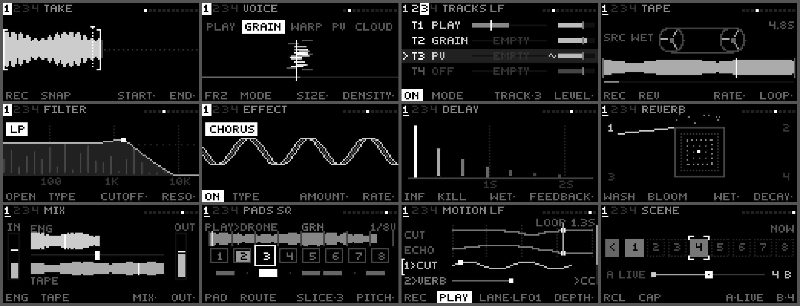

# four

four is a live sampler for [norns](https://monome.org/docs/norns/). Record your synth or
drum machine onto four stereo tracks, then loop, stretch, grain and filter the takes as
you play.

The website walks through every page on four's real screen:
[alejo-end.github.io/four-site](https://alejo-end.github.io/four-site/).


*A render of four on a pocket-sized version of the norns shield, built around a Raspberry
Pi Compute Module 4, still in design.*

## What it does

Anything at line level goes in: a synth, a drum machine, a tape deck, another norns. Each
track records its own take of up to 60 seconds, loops it and runs it through its own chain:

- A voice. PLAY is the take as tape, with varispeed. GRAIN sprays it into a cloud of
  stereo grains. WARP and PV change the speed and keep the pitch. CLOUD is Mutable
  Instruments Clouds.
- A diode ladder filter (low-pass, high-pass or band-pass), then drive and crush.
- Two effect slots: chorus, flanger, wobble, resonator, ring modulator or echo.
- Sends to the other tracks, to a shared bucket brigade delay and to a shared room.

Under the tracks runs a softcut tape loop that records the input or four's own output.
PADS cuts the loop into eight slices, and a step sequencer can play them. SCENE keeps
whole sounds in eight slots and crossfades between two of them. MOTION loops your knob
moves, and four modulators swing the sound around wherever you left the knobs. It all
sits on three keys and three encoders. A grid is optional, and every parameter maps to
MIDI.

four is in active development. Most of it is measured on a norns, and the newest sounds
still wait for a proper listen.

## Install

In maiden, type this line, then SYSTEM > RESTART and pick four from SELECT:

```
;install https://github.com/Alejo-end/four
```

You need a norns and a line-level sound on its input. four is built and tested on a norns
shield with a Raspberry Pi 4. Older norns hardware has not been tried.

## First minutes

1. On TAKE, press K2, play something, then press K2 again. The take loops.
2. E2 and E3 move the start and the end of the loop.
3. Turn E1 to VOICE and press K3 to step through the voices.
4. Go on to FILTER and EFFECT and turn things up.
5. The delay and the reverb stay silent until a track sends to them. On TRACKS, hold K1,
   turn E2 to D or R and turn E3 up.
6. Hold K1 and turn E1 to pick track 2. Record a second take there.
7. On SCENE, press K3 to capture the sound. Change things, then turn E3 to fade back to it.

Two moves work on every page. K1 + K2 stops and starts everything. A tap of K1 + K3 turns
every effect off.

## The pages



TAKE, VOICE, TRACKS, TAPE, FILTER, EFFECT, DELAY, REVERB, MIX, PADS, MOTION and SCENE.
E1 moves between them, and the bottom of the screen names what K2, K3, E2 and E3 do on
each one.

## More

- [The full guide](doc/manual.md): every page with pictures, the grid, MIDI, saving and
  troubleshooting.
- [Every key and knob](doc/controls.md), generated from the code.
- Optional extras: the FourStretch plugin, four's own stretch, grain, delay and reverb
  code, built on the norns ([ugen/README.md](ugen/README.md)). A monome grid or a
  Launchpad Mini MK3.

## License

four is free software under the [GNU General Public License v3](LICENSE). You can use
it, change it and share it.
