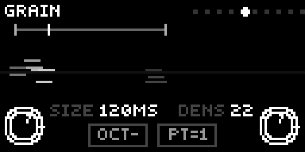
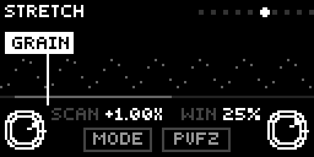
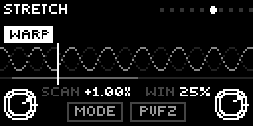
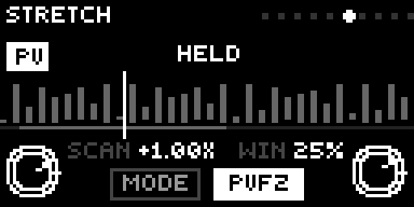
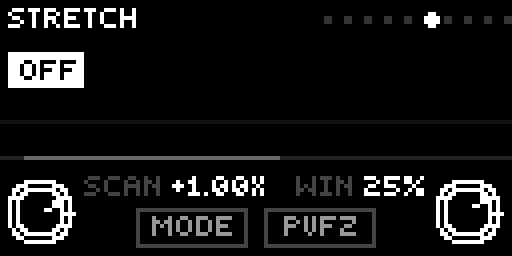
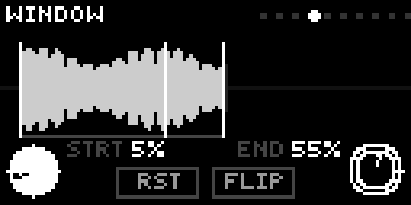

# mangler

A monome **norns** live stereo sample-mangling instrument for external line-level gear
(synth, drum machine, anything line-level). Performance-first: record, window, granulate,
time-stretch, tape-loop, filter, delay, reverb — played from **3 keys + 3 encoders**, with
**every parameter MIDI-mappable**. An optional **grid** (monome, or a launchpad-style MIDI
grid via midigrid) adds a pad surface. Built for **shield XL on Raspberry Pi 4**.

## What it does

- **Record** live stereo input into the engine.
- **Playback window** — select a slice of the recording with a start and stop.
- **Granular** clouds from the windowed slice.
- **Time-stretch** in several modes, independent of pitch.
- **Tape-like** playback — varispeed, reverse, looping, freeze (via softcut).
- **Filter** — low-pass / high-pass / band-pass.
- **FX** — delay (time + feedback) and reverb, each with its own dry/wet.
- **MIDI** — map any parameter to a CC from the PARAMS menu (saved per-script as a PMAP).
- **Chromatic note input** — play the sample from a MIDI keyboard (or a USB typing
  keyboard), retuning pitch in semitones without changing speed.
- **Grid (optional)** — a monome grid, or a launchpad-style MIDI grid via the midigrid
  library: note pads, window/loop slice pads, and transport toggles.

> **Status:** Stage 4 (filter + delay + reverb), on-device gate pending. Stages 1–3
> (record/granular/window, stretch modes, tape looper) have passed on hardware. See
> `CLAUDE.md` for the build order and `doc/spec.md` for the full design.

## Screens

Every frame below is real output — the actual script run through the offscreen renderer
(`tools/uisim/`) with a scripted take, tape loop, and live FX.

The **"Toy" UI**: a small title that never disappears, the armed-status flags beside it,
uniform page dots top-right, and a footer that mirrors the panel — two knobs (they fill
solid while you turn them), the live E2/E3 values, and the K2/K3 pills. No top-right pocket;
the value lives in the footer.


| | |
|---|---|
| <br>**MIX** — two lanes with the crossfader between: ENG scatter (thickens toward the engine, flat when off) over the TAPE waveform (height rides the fade) | <br>**LEVEL** — two stereo meter bars (L/R), peak-hold pips and a clip lamp; the tab under each bar is the gain (hold K1: MON/HP) |
| <br>**REC** — the buffer strip with the grain cloud; the write head lays material with an afterglow trail; empty buffer says `EMPTY - K2 REC` | <br>**GRAIN** — a stereo grain field: ticks stretch with size, fill with density, and drift with pitch; source ruler up top |
| <br>**TAPE** — two reels spinning at the real rate (hubs + spokes), tape guides between, loop + head below | <br>**FILTER** — the engine's real response: filled passband, shimmering spectrum ticks, node dot at the cutoff (hold K1: D/W + GRN) |
| <br>**DELAY** — one bounce per repeat; feedback shrinks the arcs | <br>**REVERB** — a room seen from above: walls grow with size, rays bounce to the listener, a ping pulses from the source (hold K1: MIX + D/W) |

**STRETCH** draws the active algorithm's own texture — grains, an overlapped warp window,
spectral columns — and lies flat when the voice is off:

| | |
|---|---|
| <br>**GRAIN** — the wave sampled as grains | <br>**WARP** — a ghost window overlaps (warp rand shakes it) |
| <br>**PV** — spectral columns; frozen, they stand still | <br>**OFF** — voice freed, nothing moves |

## Install

The git repo *is* the script. Copy it into the norns scripts folder:

```sh
rsync -av --delete --exclude='.git' ./ <norns>:~/dust/code/mangler/
```

Then on the norns, `;restart` (or SELECT > mangler). `--delete` is important: it removes any
stale copy of the engine from the device, which would otherwise hang every script on
"LOADING".

A **private repo changes nothing** here: rsync (or scp, or Finder → Go → Connect to Server →
`smb://norns.local`) copies from your machine over the local network — GitHub is never
involved. maiden's `;install <url>` is only for when the repo is public (or you embed an
access token in the URL, which then sits in plaintext on the device — avoid).

### Single-file build

`dist/mangler_single.lua` is the whole control layer amalgamated into one file — handy for
pasting into maiden's editor or dropping in as `dust/code/mangler/mangler.lua` without
syncing `lib/*.lua`. It is **generated** (`lua tools/amalgamate.lua`, verified byte-identical
to the modular build by the render suite) — edit the modules, not this file. The engine is
not inlined: `lib/Engine_Mangler.sc` must still be present, and exactly **once** on the
whole device.

## Controls (3 keys + 3 encoders)

| control | function |
|---------|----------|
| **E1**  | select page (**hold K1**: jump page family — source · shape · tape · fx) |
| **E2 / E3** | the page's two parameters — value + knob live in the footer; the knob fills while you turn it (**hold K1** for the alt parameter on each: e.g. FILTER → D/W + GRN, REVERB → MIX + D/W) |
| **K1** (hold) | alt / shift modifier |
| **K2 / K3** | the page's two actions (toggle or momentary) — the footer pills invert while active |

Pages cycle with E1:
`MIX · LEVEL · REC · WINDOW · GRAIN · STRETCH · TAPE · FILTER · DELAY · REVERB`.
The full page → encoder/key map is in `doc/spec.md` (§10).

Turning any encoder flashes the value top-right in a framed box — always
legible, whatever the page is drawing — then it gets out of the way:



### MIDI

Every continuous and toggle parameter is MIDI-mappable: in the norns PARAMS menu, long-press
a parameter and assign a CC. Mappings are saved per-script to `data/mangler/mangler.pmap` and
reloaded automatically.

### Playing notes (chromatic pitch)

Plug a **MIDI keyboard** into the norns and play: each note-on retunes the sample's pitch in
semitones, independent of playback speed, in all three stretch modes. MIDI note 60 plays the
sample as recorded (set by the `root note` param), with a ±24 semitone range. Notes retune
the running voice — last-note priority, no envelope — so it plays like tuning a texture, not
a polyphonic sampler.

A **USB typing keyboard** works too, Ableton-style musical typing: the `A` row is the white
keys (`A` = as recorded), the `W` row the black keys, and `Z` / `X` shift the octave.

Settings live in **PARAMS > keys**: note input on/off, MIDI channel (default: any), root
note, typing-keyboard octave, and **pitch quantize** — which also snaps the pitch encoder
and any mapped CC to semitones.

### Grid (optional)

mangler needs no grid — but if one is attached it becomes an 8×8 performance surface.
A **monome grid** just works. A **launchpad-style MIDI grid** (Launchpad family, APC mini)
works through the community [midigrid](https://github.com/miker2049/midigrid) library:
install it on the norns (maiden REPL: `;install https://github.com/miker2049/midigrid`),
plug the controller in, and load mangler — it is adopted automatically whenever no real
monome grid is attached.

```
row 1    ENGINE  [rec] [freeze]  ·  [OFF][GRAIN][WARP][PV]  [pv freeze]
row 2    TAPE    [rec] [freeze] [reverse (hold)]  ·  ·  ·  ·  ·
row 3    WINDOW  8 slice pads — tap = that eighth, hold one + tap = the span
row 4    LOOP    8 slice pads for the tape loop, same gesture
rows 5–8 NOTES   two piano octaves, black row above its white row (same shape
                 as musical typing; upper pair +1 octave). row 7 corners =
                 octave −/+ · row 5 corners = pitch reset / pitch quantize
```

Pads drive the same params as everything else, so grid, keys, encoders, and MIDI CCs stay
in lockstep. The grid controller's own MIDI is excluded from chromatic note input — its
pads are pads, not notes. (The grid layer is new and not yet verified on hardware.)

## Workflows

Two complete performance walkthroughs — the same instrument, two surfaces:

- **[Standalone — 3 keys + 3 encoders](doc/workflow-standalone.md).** The core
  promise: synth in, nothing else attached. Gain-stage, chop a phrase, shape
  the slice, grow a granular soundscape, print layers to the tape, ride the
  FX, save the whole thing (tape audio included) as a PSET.
- **[With a grid](doc/workflow-grid.md).** The optional pad layer: one-tap
  transport, two-finger slicing over buffer and loop, two piano octaves to
  play the sample chromatically — while the encoders stay on the deep
  parameters. Unplug the grid and nothing is lost.

## Performance model (Pi 4)

scsynth runs on a single core; xruns appear past roughly 60% load. mangler keeps **softcut**
(a separate, near-free audio core) doing all it can — record, loop, varispeed, reverse,
filter — and puts in scsynth only what softcut cannot: granular, time-stretch, and the custom
filter/delay/reverb. The three SC playback algorithms (granular / Warp1 / phase-vocoder) are a
**mode switch** on one voice, so their cost is never paid simultaneously. Estimated all-active
worst case ≈ 35–45% of one core.

## Testing checklist

Each stage has an on-device acceptance test in `doc/spec.md`. The gate, every stage:

1. `luac5.3 -p mangler.lua` passes locally.
2. Deploy, `;restart`. The script loads to its home page with **no LOADING hang** and **no SC
   errors** in maiden.
3. Run the current stage's acceptance test from `doc/spec.md`.

Passing a stage's gate unlocks the next (current stage: see the top of `CLAUDE.md`).

## Layout

```
CLAUDE.md              agent manual: invariants, build order, current stage
README.md              this file
doc/spec.md           durable design contract (full per-stage detail)
doc/workflow-standalone.md  performance walkthrough, keys + encoders only
doc/workflow-grid.md   performance walkthrough for the optional grid layer
doc/ux-feedback.md     play-testing feedback log driving the UI polish

tools/uisim/            offscreen UI renderer: see every page as a PNG, no hardware
tools/amalgamate.lua    builds dist/mangler_single.lua from the modules
dist/mangler_single.lua  GENERATED single-file drop-in (engine .sc still required)
doc/ui/                rendered page gallery used by this README
mangler.lua            orchestrator: state, params, keys/encoders (engine.name = 'Mangler')
lib/mfont.lua          the 4x5 pixel font and type-setting routines
lib/mparticles.lua     pooled grain-cloud particle system
lib/mtape.lua          softcut plumbing: tape path, eng<>tape mix, PSET tape audio
lib/minput.lua         chromatic note input: MIDI notes + USB typing keyboard
lib/mgrid.lua          optional grid surface (monome, or midigrid controllers)
lib/mpages.lua         the screen: wave models, page bodies, header/footer
lib/Engine_Mangler.sc  the one and only SuperCollider engine file
```
