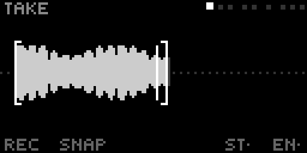
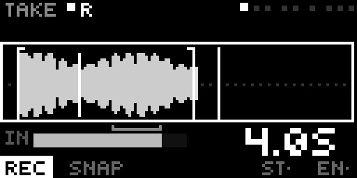
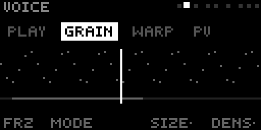
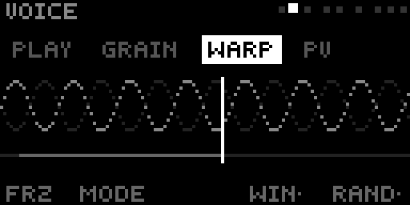
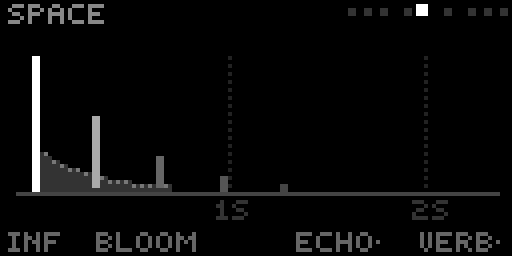
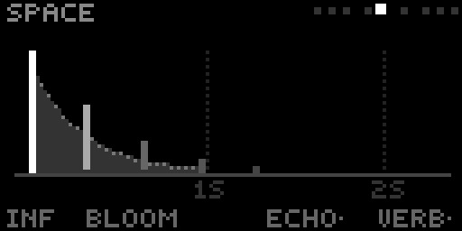
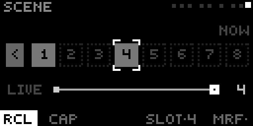

# mangler

**A live stereo sampler and mangler for [norns](https://monome.org/norns/).** (norns is a
small open sound computer from monome.) It is for anyone who wants to record live gear and
warp it on the fly: plug in a synth, a drum machine, or anything else that runs at line
level, record a phrase, and it loops straight back the way you played it. From there you can
granulate it, time-stretch it, chop it into playable slices, and run it through a filter,
delay and reverb.

You drive the whole thing with three keys and three encoders, so you never need a grid. If
you have one you can plug it in for a pad surface.


> **Status:** freshly redesigned around the spec in [doc/redesign.md](doc/redesign.md) — nine
> pages, one gesture law — and still moving. The engine is built and tested in gated stages
> on real hardware. See [CLAUDE.md](CLAUDE.md) for the current stage and the full build log.

**Contents:** [Requirements](#requirements) · [Play it in 60 seconds](#play-it-in-60-seconds) · [One gesture law](#one-gesture-law) · [What the screen always tells you](#what-the-screen-always-tells-you) · [The nine pages](#the-nine-pages) · [Playing notes](#playing-notes) · [The grid](#the-grid-optional) · [Install](#install) · [Under the hood](#under-the-hood)

## Requirements

- A **norns** running current software. Built and tested on a **norns shield XL on a
  Raspberry Pi 4**. Stock norns and older Pis are untested. They may work, but the CPU budget
  is tuned for the Pi 4, so treat anything else as unsupported for now.
- SuperCollider, which ships with norns and runs the engine.
- **Optional:** a MIDI controller, a grid (a monome grid, or a Launchpad / APC mini through
  [midigrid](https://github.com/miker2049/midigrid)), and two plugins for the fuller sound,
  [sc3-plugins](https://github.com/supercollider/sc3-plugins) (JPverb reverb) and
  [mi-UGens](https://github.com/v7b1/mi-UGens) (MiClouds granular). All optional, and mangler
  runs fine without any of them.

## Play it in 60 seconds

First time here? [Install](#install) takes about two minutes. Once it is on the norns:

1. **Record.** The script opens on **TAKE**. Tap **K2**, play a phrase, tap **K2** again —
   the window snaps to your take and loops it back dry, exactly the sound you played. A
   little **◇** lights up by the title: that mark means *what you hear is the recording,
   verbatim*.
2. **Choose a voice.** On **VOICE**, K3 cycles PLAY (the clean loop) → GRAIN → WARP → PV.
   The picture under the mode rail *is* the mode — an unbroken wave, a grain cloud,
   overlapped windows, spectral columns. The encoders always shape what you're hearing.
3. **Add space when you want it.** **FILTER** and **SPACE** (delay + reverb in one picture)
   start neutral — turn ECHO and VERB up to add them. The ◇ goes out the moment anything
   touches the sound.
4. **Play it as slices.** On **PADS**, the take sits chopped into 8 numbered slices over a
   16-step Euclidean row: E2 picks a slice, K2 plays it, E3 dials in a rhythm, K3 runs it.
5. **Loop your hands.** On **MOTION**, tap K2, move any knob — a filter sweep, an echo
   swell — tap K2 again. The movement itself loops, one lane per knob you touched, drawn as
   curves.
6. **Keep sounds you like.** On **SCENE**, K3 captures everything into a slot. Later, *hold*
   K2 on it to **peek** — the whole instrument slides into that sound, and slides home when
   you let go. Tap K2 to keep it. The **◄** cell always holds where you just were.

> **Dry by default.** A fresh recording is your sample, untouched. The filter is wide open,
> drive is a true bypass at zero, and delay and reverb stay silent until you turn them up.
> The ◇ purity mark by the title is that promise, kept live: it shows only while the output
> is your take, verbatim.

## One gesture law

Every key obeys the same physical rule, on every page:

> **Press engages now. Let go quickly and it latches. Hold it and it's a *punch* — it lets
> go when you do.** If something is already latched on, any press turns it off.

That one law makes everything playable two ways: tap **REC** to arm a take or *hold it* to
punch a stab of input into the buffer; hold **REV** on TAPE to flip the loop for a beat or
tap to leave it backwards; hold **OPEN** on FILTER for a sweep that returns by itself; hold
**INF** on SPACE for a dub grab; hold **RUN** on PADS to stutter the sequencer; hold **RCL**
on SCENE to *borrow* a scene and come home on release. If a word in the footer is still
inverted after your finger is off, it's latched.

| | |
|---|---|
| **E1** | Select the page — nine stations along the signal path. |
| **E2 / E3** | The page's two shaping knobs. Hold K1 for the second pair. Values appear only while you turn (the footer word swells), so the screen stays quiet. |
| **K1** (hold) | Shift. The footer swaps whole — alt knobs, and the two global keys below. A bar appears at the footer's left edge while it's down. |
| **K2 / K3** | The page's two gestures, named in the footer, under the law above. |
| **K1+K2** | **STOP / START** — on every page, no exceptions. Tap to choke everything (the title inverts), tap again for the exact mix back. Hold it for a mute stab. Also the space bar of a USB keyboard, the grid, and MIDI (`stop all`). |
| **K1+K3** | **DRY**, tap — one press throws the playback path clean: delay, reverb, shimmer, drive and clouds feedback to zero, filter open. **Hold it ~1s** and it becomes the **eraser**: a ring fills beside the word, and when it closes, the page's material is wiped (the take, the tape loop, the pattern, a motion lane, a scene slot). Let go early and nothing happens. |
| **K1+E1** | The **morph, from anywhere** — sweeps the whole instrument toward the selected scene without leaving your page. Sweep back to zero and you land exactly where you started. |

## What the screen always tells you

The header and footer never change shape — learn them once and every page is pre-learned.

- **Top left:** the page name. It inverts while STOPped.
- **◇** beside it: the purity mark — lit only while the output is your take, verbatim.
- **Flags:** `R` / `T` / `M` blink fast while the take, the tape, or motion is *writing*
  (fast blinking always means writing); a steady `▸` means the sequencer runs; `FZ` / `TF`
  are the freezes.
- **Top right:** nine dots, grouped `3·2·1·3` — TAKE VOICE TAPE · FILTER SPACE · MIX ·
  PADS MOTION SCENE. The nav row is the signal map.
- **Footer:** four quiet words — K2, K3, then E2·, E3·. Latched things stay inverted;
  numbers exist only while you're asking.

## The nine pages

Every frame below is real output from the offscreen renderer in `tools/uisim/`, drawn over a
scripted take. Every knob is also a parameter in **PARAMS** (organized by these same pages),
where you can MIDI-map it.

| # | page | what it's for |
|---|---|---|
| 1 | [TAKE](#take) | record the material and frame what plays |
| 2 | [VOICE](#voice) | how the take plays: PLAY · GRAIN · WARP · PV |
| 3 | [TAPE](#tape) | a second, parallel loop deck |
| 4 | [FILTER](#filter) | tone |
| 5 | [SPACE](#space) | echoes and reverb, one picture |
| 6 | [MIX](#mix) | the console: in → decks → out |
| 7 | [PADS](#pads) | the take chopped into 8 slices, played and sequenced |
| 8 | [MOTION](#motion) | record and replay your knob moves |
| 9 | [SCENE](#scene) | keep whole sounds, morph between them, always have a way back |

### TAKE



The material. Your recording sits bright inside the **window brackets** (E2/E3 move them,
finer as the window tightens; K1+E2 slides the whole window), dim outside them, and the
unwritten buffer is a dotted line. **K2** records — tap to arm, tap to commit (the window
snaps to the take), or hold to punch a stab straight in. **K3** snaps the window full and
back. While armed, the frame blinks, the write head sweeps with a hot trail, the seconds
count big, and the input meter shows a bracket: keep your peaks inside it for a clean take.



`RSMP` / `REGN` badges appear when resampling or regeneration is feeding output back into
the buffer (both live in PARAMS). Loading a wav instead of recording: PARAMS > take.

### VOICE


How the take plays. The rail names the mode — **K3** cycles PLAY → GRAIN → WARP → PV (OFF
lives in PARAMS; stopping is STOP's job) — and the texture below *is* the mode:





**K2** freezes (hold for a stutter, tap to hold it — `FZ` joins the header). The encoders are
**mode-contextual**: in GRAIN they're SIZE and DENS; everywhere else SPEED and PITCH (always
on the shift pair too). Speed goes through zero — turn it negative and the take plays
backwards. Deep granular character (spread, texture, position, feedback, lofi, jitter) lives
in PARAMS > voice.

### TAPE


A second deck: softcut records the raw input on its own 60-second loop, independent of the
drone. The loop is drawn as a **belt** — material rides the top run, the head sweeps it with
a trail, the arrow on the return run shows direction, the rate sits inside. **K2** records
(hold = punch-in overdub, the freshly written stretch glows). **K3** reverses — hold to flip
for a moment, tap to latch it backwards. E2 is the rate (through zero = backwards), E3 the
loop length; the shift pair is overdub decay and loop position. The eraser (K1+K3 held)
wipes the loop.

### FILTER


Tone. The curve is the engine's *real* response — cutoff (E2) drags the bright node along
the labeled rails, resonance (E3) raises the bump, and drive (K1+E2) flecks the curve with
grit instead of showing you a number. **K2 OPEN** throws the filter wide — hold it for a
sweep that comes back by itself, tap to park it open, tap again to return to your carved
tone. **K3** cycles LP / HP / BP.

### SPACE



Delay and reverb as one picture: *when does the sound come back?* The spike is now; the taps
are your echoes (spacing = TIME, decay = feedback); the slope under them is the reverb tail
(reach = DECAY); motes climb off it when shimmer is up. Dotted rails mark 1s and 2s. E2/E3
are the two amounts, ECHO and VERB; the shift pair is TIME and DECAY. **K2 INF** pins the
delay loop (hold for a dub grab, tap to latch — the taps stop decaying, which is the
warning). **K3 BLOOM** surges the shimmer. When the tail runs off the right edge into the
hatched margin, the sound will outlive your patience:



Everything deeper — damp, size, early, mod, EQ, cuts, shimmer pitch/tone — is PARAMS > space.

### MIX


The console: input meter → the two decks → master VU, on one screen. Each lane shows its
deck's *real* level — a deck you can't hear lies flat, and the tape head is drawn whenever
the tape holds audio, so a deck you forgot you armed can never hide. E2 crossfades, E3 is
the master; the shift pair is input and monitor. **K2/K3** throw the crossfade hard to
either deck — hold for a stab, tap to latch, tap again to come back.

### PADS


The take, chopped. The window sits zoomed across the top, divided into 8; the numbered cells
under it are the slices; the row at the bottom is a 16-step Euclidean rhythm that re-fires
the selected slice. **One cursor does everything**: E2 selects the slice that **K2** plays
(hold = gate it, tap = fire it) *and* that the sequencer targets — browsing slices while it
runs re-aims the rhythm live. E3 is the hit count (turning it *is* sequencing); the shift
pair is length and clock division. **K3** runs it — hold for a stutter. Route MIDI/grid
notes to the pads in PARAMS > keys (`pad input`), and the header reads `PLAY>PADS`.

### MOTION


A loop pedal for your hands. Tap **K2**, move knobs — *on any page* — tap K2 again: every
knob you touched becomes a lane, drawn as a curve and named with its page's own word (SPEED,
CUT, ECHO…). One playhead crosses all of them with a bright dot at each: the value sounding
right now. **K3** plays/stops the loop; holding K2 while it plays punches a replacement into
just the lanes you move. E2 selects a lane, E3 scales the whole loop's depth. The eraser
wipes the selected lane.

### SCENE


Whole sounds, kept. **K3** captures everything (the mangle, not the audio) into the selected
slot; **E3 morphs there** from whatever you're playing — sweep back to 0 and you're exactly
home. One captured scene is enough to play with.

**Hold K2 to peek**: the instrument slides into the scene while your finger is down and
slides home when you release. Tap K2 to commit.



**The ◄ cell is the way back.** Every commit and every chaos throw parks the sound you were
just making in ◄ automatically. Select it (E2 left of slot 1) and tap K2 — you're back. No
arming, no ceremony. Recalls can land on the next beat or bar (K1+E2); a queued slot blinks
with a little wedge counting down. Holds, note routing and the buffer writers deliberately
don't ride a morph, so the page says `K2 TO LAND THE REST` when a tap is needed to finish
the trip. Map `chaos throw` to a footswitch: hold for bounded mayhem, release to land back
on ◄. Scenes save and load with your PSET.

## Playing notes

A MIDI keyboard retunes the sample chromatically. Note 60 plays it as recorded, and you get
±24 semitones with the pitch staying independent of the speed. A USB typing keyboard works
Ableton-style: the A row plays white keys, the W row plays black keys, and Z/X shift the
octave. Turn pad input on and the notes trigger the 8 PADS slices polyphonically instead.
The settings are in **PARAMS > keys**.

**MIDI mapping.** Every continuous and toggle parameter can be mapped. Long-press it in
**PARAMS** and assign a CC. Your mappings save per script to `data/mangler/mangler.pmap` and
reload automatically.

## The grid (optional)

A monome grid works as-is; a Launchpad or APC mini works through
[midigrid](https://github.com/miker2049/midigrid). The surface has a **spine that never
moves**, so your hands always know where things are:

- **Row 1 — scenes, from any page.** Tap a slot to recall it, *hold to peek* (same law as
  the key). On the SCENE page, hold the CAP or CLR pad below and tap a slot to capture or
  clear.
- **Row 2 — the state strip:** take rec · tape rec · tape reverse (hold) · freeze · tape
  freeze · seq run · DRY · STOP.
- **Rows 3–6 — the workspace**, which follows the page: normally window and tape-loop
  spans (hold one pad, tap another to stretch a region) plus the mode radio; on **PADS**
  the 16 steps, slice select, run/clear; on **SCENE** aim, the morph bar, and
  CAP · CLR · CHAOS(hold) · ◄.
- **Rows 7–8 — one piano octave**, black keys over white, with octave −/+ at the row-7
  corners. The pads play the drone pitch, or the slices when pad input is on.

## Install

**First time?** Copy the folder onto your norns and restart. That is the whole install:

```sh
rsync -av --delete --exclude='.git' ./ we@norns.local:~/dust/code/mangler/
```

Replace `we@norns.local` with your norns. `we` is the default norns user, and `norns.local`
is the default hostname. If that name does not resolve, use the IP address instead (you can
read it on the device under SYSTEM > WIFI), for example
`we@192.168.1.23:~/dust/code/mangler/`.

Then load it. Open **maiden** (the norns web editor, at `http://norns.local/` or
`http://<your-norns-ip>/` in a browser) and type `;restart` in the REPL at the bottom, or
just pick **mangler** from the SELECT menu on the device itself.

**Why `--delete` matters:** it clears out any stale copy of the engine. A leftover engine file
would otherwise hang every script on "LOADING", so it is worth keeping. A private repo is
fine, since rsync copies over your local network and GitHub is never involved.

**Single-file drop-in.** `dist/mangler_single.lua` is the whole control layer amalgamated into
one file (generated by `lua tools/amalgamate.lua` and byte-checked against the modules, so
edit the modules, not this file). You still need the engine `lib/Engine_Mangler.sc` present,
and exactly once anywhere on the device.

**For the best sound**, install the two optional plugins from
[Requirements](#requirements): [sc3-plugins](https://github.com/supercollider/sc3-plugins) for
JPverb, and [mi-UGens](https://github.com/v7b1/mi-UGens) for MiClouds. Both are fully guarded:
if a plugin is missing, mangler falls back to stock SuperCollider (FreeVerb or GrainBuf) and
loads normally. Nothing can brick loading.

## Under the hood

**Performance on the Pi 4.** scsynth runs on a single core and starts to xrun past about 60%,
so softcut (a separate, near-free core) handles the tape: record, loop, varispeed and
reverse. scsynth only does what softcut can't, which is the granular, the stretch and the
custom FX. The three drone algorithms are one voice with a mode switch, so you never pay for
all of them at once.

**Params are the single source of truth.** Keys, encoders, MIDI and the grid all drive the
same `params:*`, so they stay in lockstep. This is also why every parameter is MIDI-mappable
for free.

**Staged and gated.** The engine grows in stages, each one tested on the device before the
next. The current stage and the full build log are at the top of [CLAUDE.md](CLAUDE.md); the
UI's design spec is [doc/redesign.md](doc/redesign.md) and the engine design lives in
[doc/spec.md](doc/spec.md).

```
mangler.lua              orchestrator: state, params, the punch-law keys and encoders
lib/Engine_Mangler.sc    the one and only SuperCollider engine
lib/mpages.lua           the screen: the nine dominant objects, header and footer
lib/mtape.lua            softcut tape path and the engine/tape mix
lib/minput.lua           MIDI and typing-keyboard note input
lib/mgrid.lua            optional grid surface (the spine + page workspaces)
lib/mmotion.lua          gesture looper: records and replays the param stream
lib/mseq.lua             Euclidean step sequencer driving the slice voices
lib/mscenes.lua          scenes, the morph, and the ◄ way back
lib/mfont.lua  lib/mparticles.lua   pixel font and pooled grain particles
tools/uisim/             offscreen UI renderer, every page as a PNG, no hardware
dist/mangler_single.lua  generated single-file drop-in
```

## License

No license has been chosen yet, so for now the code is all rights reserved by default. If you
want to build on it, ask.
