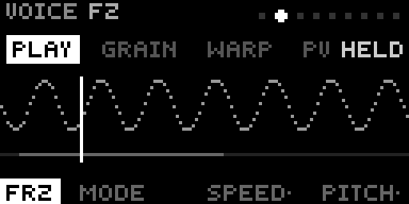
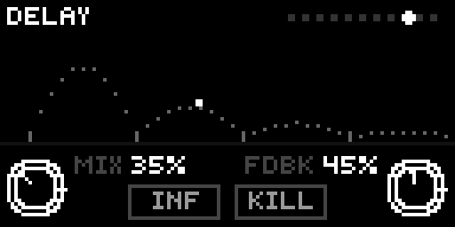
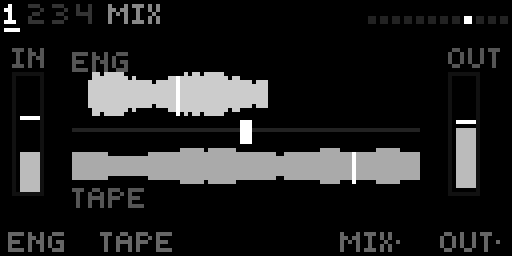
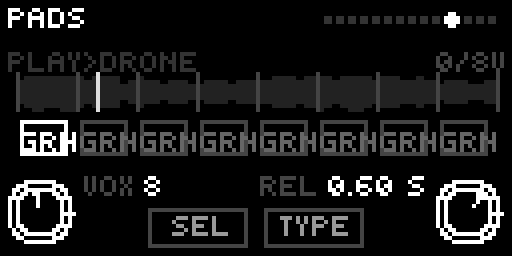

# mangler

A live stereo sampler and sound mangler for [norns](https://monome.org/norns/). Record
line-level input, loop it back verbatim, then process it: time-stretch, granular clouds,
tape-style varispeed and looping, a filter, delay, reverb and shimmer, plus per-slice
polyphonic voices, a gesture (motion) looper, and scene morphing.

Played with **three keys and three encoders** — no grid required. An optional grid adds a pad
surface. Every parameter is a norns param and is MIDI-mappable.

Built and tested on a **norns shield XL on a Raspberry Pi 4**. Stock norns and older Pis are
untested; the CPU budget is tuned for the Pi 4.


**Contents:** [Requirements](#requirements) · [Install](#install) · [Controls](#controls) ·
[Screen](#screen) · [Pages](#pages) · [Notes](#playing-notes) ·
[Loading and exporting](#loading-and-exporting-samples) · [Saving (PSET)](#saving-a-session-pset) ·
[Grid](#grid-optional) · [Spec](#spec) · [Architecture](#architecture)

> **Status:** in active development, built in gated stages on hardware. See
> [CLAUDE.md](CLAUDE.md) for the current stage and build log, [doc/redesign.md](doc/redesign.md)
> for the UI spec, and [doc/spec.md](doc/spec.md) for the engine spec.

## Requirements

- A **norns** on current software, with SuperCollider (ships with norns).
- **Optional:** a MIDI controller; a grid — a monome grid, a **Launchpad Mini MK3** (driven
  natively in colour), or another Launchpad / APC mini through
  [midigrid](https://github.com/jaggednz/midigrid).
- **Optional plugins** for the fuller sound: [sc3-plugins](https://github.com/supercollider/sc3-plugins)
  (JPverb reverb) and [mi-UGens](https://github.com/v7b1/mi-UGens) (MiClouds granular). Both are
  guarded — if absent, mangler falls back to stock SuperCollider (FreeVerb / GrainBuf) and loads
  normally.

## Install

Copy the folder to the norns and load it:

```sh
rsync -av --delete --exclude='.git' ./ we@norns.local:~/dust/code/mangler/
```

Replace `we@norns.local` with your norns (default user `we`, default host `norns.local`; use
the IP from SYSTEM > WIFI if the name does not resolve). Then type `;restart` in
[maiden](http://norns.local/) or pick **mangler** in the SELECT menu.

- **`--delete` is required.** It removes any stale copy of the engine. A second
  `Engine_Mangler` class anywhere under `~/dust/code/` hangs every norns script on "LOADING".
- **Editing the engine** (`lib/Engine_Mangler.sc`) requires SYSTEM > RESTART; reloading the
  script is not enough. Lua-only changes just need a reload.
- **`dist/mangler_single.lua`** is a generated single-file build of the control layer. The
  engine `lib/Engine_Mangler.sc` must still be present, exactly once on the device. Edit the
  modules, not the generated file (`lua tools/amalgamate.lua` regenerates it).

## First session, five minutes

Plug something line-level into the input, load mangler, and:

1. **Record.** On **TAKE** (page 1), press **K2**, play a phrase, press **K2** again. The
   window snaps to what you played and it loops back **dry** — exactly what you recorded.
   The ◇ next to the title says so.
2. **Mangle it.** Turn **E2/E3** on TAKE to move the window edges. Go to **VOICE** and tap
   **K3** to cycle PLAY → GRAIN → WARP → PV — the screen texture *is* the mode. In GRAIN,
   E2/E3 are size and density.
3. **Add colour.** **FILTER** E2 sweeps the cutoff (K1+E2 = drive). **DELAY** E2 brings the
   echo in, E3 feeds it back. **REVERB** E2 opens the tail. Everything starts at zero — you
   only hear what you dialled in.
4. **Play it like a drum.** On **PADS**, **E2** selects one of the 8 slices of your take and
   **K2** plays it (hold = gate, tap = a short hit). Give the slice its own voice (GRAIN or
   clean SLICE) with **K1+E2** and its own pitch with **E3**. Plug in any MIDI or USB typing
   keyboard and tap **K3 (ROUTE)** to play the slices polyphonically.
5. **Keep the sound.** On **SCENE**, tap **K3 (CAP)** to capture everything into the selected
   slot. Change the sound completely, then turn **E3**: you morph from where you are toward
   the stored scene — and back to zero lands you exactly home. Tap **K2 (RCL)** to commit;
   hold K2 to *peek* (borrow it, release to come home).
6. **The two reflexes.** **K1+K2** = STOP/START, anywhere. **K1+K3** = DRY, anywhere — the
   playback path snaps clean. If a knob adventure goes wrong: select **◄** on SCENE and tap
   K2 — the way back.

## Controls

**Gesture law** (applies to K2 and K3 on every page):

> Press engages the action immediately. Release within ~300 ms and it **latches** (stays on).
> Hold longer and it is a **punch** — it releases when you do. Pressing a key that is already
> latched turns it off.

A footer word that stays inverted after you lift your finger is latched.

| Control | Action |
|---|---|
| **E1** | Select the page (ten stations along the signal path). |
| **E2 / E3** | The page's two shaping knobs. Hold **K1** for the second (alt) pair. Values show in the footer only while you turn. |
| **K1** (hold) | Shift: swaps to the alt knobs and the two global keys below. |
| **K2 / K3** | The page's two gestures, named in the footer, under the gesture law. |
| **K1 + K2** | **STOP / START**, every page. Tap chokes all output (the title inverts); tap again restores the exact mix; hold for a mute stab. Also the USB space bar, the grid, and MIDI (`stop all`). |
| **K1 + K3** | **DRY** (tap): sets the playback effects — delay, reverb, shimmer, drive, clouds feedback — to zero and opens the filter. **Hold ~1 s** (a ring fills beside the word) to **ERASE** the current page's material: the take, tape loop, motion lane, or scene slot. Release before the ring closes and nothing happens. |
| **K1 + E1** | **Morph** toward the selected scene, from any page. Sweep back to zero to return exactly where you started. |

Every knob is also a parameter in **PARAMS**, grouped by page, where it can be MIDI-mapped.

## Screen

The header and footer keep the same layout on every page.

- **Top-left:** the page name (inverts while stopped), then the **◇** purity mark — lit only
  while the output is the recording, verbatim (it goes out the moment any effect touches the
  sound).
- **Write flags:** `R` / `T` / `M` blink fast while the take, tape, or motion is *writing*.
  `FZ` / `TF` = the voice / tape freezes.
- **Top-right:** ten page dots, the current page a filled block.
- **Footer:** `K2  K3 | E2·  E3·`. Each shows the full word at rest; while you turn a knob the
  word abbreviates and its value appears. Latched keys stay inverted.

## Pages

Frames below are rendered from `tools/uisim/` over a scripted take.

| # | Page | Purpose |
|---|---|---|
| 1 | [TAKE](#take) | record the material, frame what plays |
| 2 | [VOICE](#voice) | how the take plays: PLAY · GRAIN · WARP · PV |
| 3 | [TAPE](#tape) | a second, parallel loop deck |
| 4 | [FILTER](#filter) | tone |
| 5 | [DELAY](#delay) | feedback echoes |
| 6 | [REVERB](#reverb) | the tail, and shimmer |
| 7 | [MIX](#mix) | input → decks → output |
| 8 | [PADS](#pads) | the take chopped into 8 playable slices |
| 9 | [MOTION](#motion) | record and replay knob moves |
| 10 | [SCENE](#scene) | store, recall, and morph whole sounds |

### TAKE


The recording sits inside the **window brackets** (bright in-window, dim outside); the
unwritten buffer is dotted. The **read (playback) head** is a dashed column with a caret above
the strip; the **write head**, while recording, is a solid line with a comet-tail glow — two
distinct shapes so they never read as one. **E2 / E3** move the window edges (finer as it
tightens); **K1+E2** slides the whole window. **K2** records — tap to arm, tap again to commit
(the window snaps to the take), or hold to punch input straight in. **K3** snaps the window
full and back. While armed, the write head sweeps, elapsed seconds count, and the input meter
shows a target bracket. `RSMP` / `REGN` badges show when resample or regen is feeding output
back into the buffer (both in PARAMS).


### VOICE



How the take plays. **K3** cycles PLAY → GRAIN → WARP → PV (OFF is in PARAMS; stopping is
STOP's job). The texture drawn below is the active mode:


**K2** freezes (hold to stutter, tap to hold — `FZ` joins the header). The encoders are
**mode-contextual**: in GRAIN they are SIZE and DENS; otherwise SPEED and PITCH (also on the
alt pair everywhere). Speed is bipolar — negative plays the take backwards; pitch is
independent. Grain character (spread, texture, position, feedback, lofi, jitter) is in
PARAMS > voice.

### TAPE


A second deck: softcut records on its own 60-second loop, independent of the voice. The two
**reels** turn in the transport direction (reverse spins them backward, stopped stands still)
above the loop track and playhead. **K2** records (hold = punch-in overdub). **K3** reverses —
hold to flip for a moment, tap to latch it backwards. **E2** is the rate (bipolar), **E3** the
loop length; the alt pair is overdub decay and the tape **source**. K1+K3 (held) erases the
loop.

The **source** (K1+E3) sets what the tape records: DRY the raw input (default), WET the
processed voice output (filter/delay/reverb), or a blend — so the tape becomes a print /
resample stage you can mangle further. When it is not fully dry the page shows `SRC WET`.

### FILTER


The filter is a DFM1 diode ladder (analog resonance and drive character); the curve
approximates its response. **E2** is the cutoff (the node on the labeled rails), **E3** the
resonance, **K1+E2** the drive (post-filter tanh saturation; grit on the curve, a true bypass
at zero). **K2 OPEN** throws the filter wide — hold for a sweep that returns on release, tap to
park it open. **K3** cycles LP / HP / BP.

### DELAY



A feedback delay. The spike is the dry onset; the taps are the echoes — spacing = TIME, height
decaying by the real FEEDBACK. **E2** is the mix (a progressive fade — a low setting is a small
amount, dry stays full), **E3** the feedback, **K1+E2** the time. Feedback spans a smooth few →
many (10+) → near-infinite (the curve is warped so the useful range is not all crammed into the
last few percent). **K2 INF** pins the feedback to a self-sustaining hold (a dub grab; the taps
stop decaying). **K3 KILL** throws the mix to zero. **K1+E3** sets the tempo **sync**: FREE
uses the time knob; a division (1/16 … 1/2, with dotted values) locks the delay to the clock
and follows tempo changes with a tape-style glide.

### REVERB


The reverb tail: a filled slope whose reach is the DECAY, with reflection dots that space by
SIZE and darken toward the tail by DAMP; shimmer motes climb off it when up. **E2** is the mix,
**E3** the decay; the alt pair is SIZE and DAMP. **K2 WASH** swells the tail to a near-infinite
hall; **K3 BLOOM** surges the shimmer. Reverb is JPverb's full attribute set when installed —
early diffusion, modulation, EQ and crossovers, plus shimmer pitch/tone, are in PARAMS > reverb.
Both mixes start at zero, so a fresh take is dry.

### MIX



Input meter → the two decks → master VU. Each lane is drawn at its deck's real level, so a deck
you cannot hear reads flat and one you left armed cannot hide. **E2** crossfades the voice and
tape decks, **E3** is the master; the alt pair is input and monitor. **K2 / K3** throw the
crossfade hard to the engine or tape deck (hold for a stab, tap to latch).

### PADS



The window chopped into 8 slices, played polyphonically over the voice. The strip is the take
zoomed full width, divided into eight; the numbered cells below are the pads, the selected one
squared and lit while sounding. **E2** selects the slice (the shared cursor), **K2** plays it
(hold = gate, tap = fire), **E3** sets the selected slice's **pitch**; the alt pair is its
**voice** type and the voice **release**. **K3 ROUTE** sends MIDI/grid/keyboard notes to the
slices (the header reads `PLAY>PADS`) instead of the drone.

Each slice carries a **sound-lock**: its own voice (GRAIN or SLICE) and pitch, MIDI-mappable
and saved in the PSET. The header shows the selected lock (e.g. `SLC+5`); `pad level` (PARAMS)
sets the pad loudness. On the grid, PADS row 3 finger-drums the eight slices and row 5 selects
one to edit.

### MOTION


A gesture looper for the knobs. Tap **K2**, move any knobs (on any page), tap K2 again: each
knob you touched becomes a lane, drawn as a step curve and named with its page's word. One
playhead crosses all lanes with a dot at the value sounding now. **K3** plays / stops the loop;
holding K2 during playback punches a replacement into only the lanes you move. **E2** selects a
lane (the view scrolls to it), **E3** scales the loop's depth. **K1+E2** sets the loop
**length** in seconds — `AUTO` (the default) keeps the length you recorded; a set value retimes
the whole loop's playback speed without losing the gesture. K1+K3 erases the selected lane.

### SCENE


Whole sounds (the control state, not the audio). **K3** captures everything into the selected
slot; **E3** morphs toward that slot from wherever you are (sweep back to zero to return home).
**Hold K2 to peek** — the instrument slides into the scene while held and slides back on
release; tap K2 to commit.


The **◄ cell** is the way back: every commit and chaos throw parks the previous sound there
automatically. Select it (E2, left of slot 1) and tap K2 to return. Recalls can land now or on
the next beat/bar (E2 alt = recall mode); a queued slot blinks. Holds, note routing and buffer
writers do not ride a morph, so the page shows `K2 TO LAND THE REST` when a tap is needed to
finish. `chaos throw` (PARAMS, momentary) throws a bounded random state; release returns to ◄.
`next scene` (PARAMS, momentary — map a footswitch) advances to the next **filled** slot and
recalls it, cycling and honoring the BEAT/BAR quantize: a live set becomes stomp, stomp, stomp.
Scenes save and load with the PSET.

## Playing notes

MIDI notes retune the sample chromatically: note 60 plays it as recorded, ±24 semitones, pitch
independent of speed. A USB typing keyboard works Ableton-style — the A row is white keys, the
W row black, Z/X shift the octave. With `pad input` on, notes trigger the 8 slices
polyphonically (each with its sound-lock) instead of the drone. Settings are in PARAMS > keys.
Every continuous and toggle parameter is MIDI-mappable: long-press it in PARAMS and assign a
CC; mappings save to `data/mangler/mangler.pmap`.

## Loading and exporting samples

- **Load:** PARAMS > take > record > **load sample**. WAV, 16/24/32-bit integer or 32-bit
  float. The window snaps to the file and the waveform draws in progressively (no UI freeze on
  a long file). The loaded sample behaves exactly like a recorded take; its path rides the PSET.
- **Export:** PARAMS > take > record > **export take** writes a stereo WAV to `dust/audio`
  (`mangler-NNN.wav`), reloadable through load sample or any editor. It is a momentary
  parameter — map it to a footswitch or grid pad.
- **Print (resample the mix):** PARAMS > take > record > **print mix → take** records the
  **master output** — engine, tape deck, and effects, everything you hear — for **print
  length** seconds (0 = AUTO, the current window length), then loads the bounce back **as the
  take**: window snapped, waveform drawn, ready to mangle again. The bounce also stays on disk
  (`mangler-print-NNN.wav`), so nothing is ever lost. Momentary — a footswitch turns
  mangle → print → mangle-the-print into one stomp.

## Saving a session (PSET)

PARAMS > PSET > save/load stores the whole session: all parameters and the MIDI map, the live
take (as a private L/R pair beside the pset), the tape audio, the scene bank and safe state,
and the per-pad sound-locks.

## Grid (optional)

A monome grid works directly; a **Launchpad Mini MK3** is driven natively in colour; other
Launchpad / APC controllers work through midigrid (monochrome). The surface has a fixed spine
so the transport and scenes are always in the same place:

- **Row 1 — scenes**, from any page: tap to recall, hold to peek. On the SCENE page, hold the
  CAP or CLR pad and tap a slot to capture or clear.
- **Row 2 — state strip:** rec · tape rec · tape reverse (hold) · voice freeze · tape
  freeze · notes→pads · DRY · STOP.
- **Rows 3–6 — the workspace** (follows the page): normally window and tape-loop spans (hold
  one pad, tap another to stretch a region) plus the mode radio; on PADS the eight slice pads
  (row 3), slice select (row 5), voice toggle and route (row 6); on SCENE aim, the morph bar,
  and CAP · CLR · CHAOS · ◄.
- **Rows 7–8 — one piano octave** (black keys over white), octave −/+ at the row-7 corners.

On the Launchpad Mini MK3, pads are coloured by meaning: red = recording, green = playing,
white = playhead/selection, blue = available/empty, orange = selected slice, cyan = frozen,
purple = destructive. STOP pulses red. Colours are defined in `LP_HUE` (lib/mgrid.lua).

## Troubleshooting

- **Every script hangs on "LOADING".** Almost always a duplicate SuperCollider class: a second
  `Engine_Mangler` copy under `~/dust/code/` (redeploy with `rsync --delete`), or plugin
  `.sc` class files installed under `dust/code` (keep mi-UGens/sc3-plugins only in the
  SuperCollider Extensions folder). Errors, if any, are in maiden's **SC tab**, not matron.
- **Changed the engine but nothing changed.** `.sc` edits need **SYSTEM > RESTART**. After
  restart, the maiden load log prints `Engine.register_commands; count: 63` — a different
  count means an old engine is still live.
- **"Dry" playback has reverb on it.** Check the norns **SYSTEM reverb** (PARAMS > REVERB —
  mangler prints a note at load when it's on), a left-up `rev_mix`/`delay_mix`, or clouds
  feedback (K1+K3 DRY zeroes all of them), or you recorded with `resample` up (which bakes
  the effects into the take, by design).
- **The reverb knobs beyond decay/damp/mix do nothing.** JPverb (sc3-plugins) isn't
  installed — the guarded fallback is FreeVerb, which only honours those three.
- **A loaded sample plays ~9% fast / sharp.** It's a 44.1 kHz file; the buffer loads without
  sample-rate conversion at norns' 48 kHz. Re-export the file at 48 kHz.
- **A mystery loop plays that isn't the take.** It's the tape deck — the MIX page shows both
  decks honestly (a lane only lights if its deck holds audio and is audible). Throw MIX fully
  to ENG, or clear the tape on TAPE with the erase gesture.
- **Screen frozen or black but the script loaded.** A Lua error inside redraw — scroll
  maiden below `<ok>` for the traceback.

## Spec

**Signal path.** Line input is recorded into a 60-second stereo buffer; at the default resample
of 0 the take is the raw input, tapped before the effects, so effects are never baked into the
recording. A drone voice reads the window and passes through filter → delay → reverb (with
shimmer) → output. Output is peak-limited at 0.92; the record path has a safety limiter at
0.99 so a hot input cannot clip into the take. A parallel softcut deck records the raw input on
its own 60-second loop.

**Voice modes (VOICE).** OFF · GRAIN (granular cloud; MiClouds when installed, else GrainBuf) ·
WARP (Warp1 time-stretch) · PV (phase vocoder) · PLAY (clean varispeed loop). One voice with a
mode switch — scsynth runs on one Pi-4 core, so the algorithms are never summed. Speed is
bipolar (negative = reverse); pitch is independent of speed.

**Filter.** LP / HP / BP through a DFM1 diode-ladder filter (analog resonance and drive
character), guarded so a missing sc3-plugins falls back to a stock biquad. DFM1 has no
bandpass mode, so BP is built from a resonant low-pass peak high-passed into a band. Separate
cutoff, resonance, and drive (post-filter tanh saturation, bypassed at 0).

**Delay.** Feedback delay with time, feedback and mix (feedback low-passed and soft-clipped).
Feedback is warped so its audible repeat-count spans smoothly from a few to near-infinite. The
tape deck can also record the post-delay/reverb output (its `source` control), a print stage.

**Reverb.** JPverb's full attribute set when installed, else FreeVerb; a pitch-shifted,
band-limited shimmer recirculates into the reverb input. The reverb runs in its own synth that
is spawned only while its mix is up and freed at zero, so it costs no CPU when off. The delay
and reverb mixes fade in progressively (linear in the knob); both default to zero (dry).

**Pads and sound-locks.** The window is chopped into 8 slices played polyphonically over the
drone. Each slice has an independent voice (grain/slice) and pitch — sound-locks — that are
real params (MIDI-mappable, PSET-persisted). `pad level` sets the note amplitude.

**Motion.** Records the parameter stream as per-parameter lanes and replays them on the 15 fps
redraw clock (one loop, punch-in overdub, depth scaling, a settable loop length that retimes
playback losslessly).

**Scenes.** Eight slots of control state plus a safe (◄) state; capture, recall (immediate or
beat/bar-quantised), morph (interpolated in each parameter's own warped space), and a bounded
chaos throw. Control state only — no audio.

**Engine safety.** Optional plugins (JPverb, MiClouds, DFM1) are resolved by class at SynthDef
build time, so a missing plugin selects a stock fallback instead of failing to compile — it can
never hang loading. The project ships exactly one `Engine_Mangler` class. Parameters are the single
source of truth: keys, encoders, MIDI and the grid all drive `params:*`, which is what makes
every parameter MIDI-mappable.

## Architecture

```
mangler.lua              orchestrator: state, params, punch-law keys and encoders
lib/Engine_Mangler.sc    the one SuperCollider engine (record, voices, tape mix, FX)
lib/mpages.lua           the screen: page bodies, header, footer, waveform + wav I/O
lib/mtape.lua            softcut tape path and the voice/tape mix
lib/minput.lua           MIDI and typing-keyboard note input
lib/mgrid.lua            optional grid surface + native Launchpad Mini MK3 colour driver
lib/mmotion.lua          gesture looper: records and replays the param stream
lib/mscenes.lua          scenes, morph, and the ◄ safe state
lib/mfont.lua  lib/mparticles.lua   pixel font and pooled grain particles
tools/uisim/             offscreen UI renderer (every page to a PNG, no hardware)
dist/mangler_single.lua  generated single-file build
```

## License

No license has been chosen yet; the code is all rights reserved by default. To build on it,
ask.
