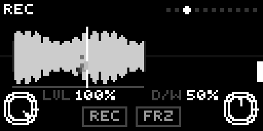

# mangler

**A live stereo sampler + mangler for norns.** Plug in a synth (or drum machine, or
anything line-level), record a phrase, and it loops back **exactly as you played it** —
then granulate it, time-stretch it, chop it into playable slices, and layer on filter,
delay and reverb. Three keys and three encoders; every knob is MIDI-mappable; an optional
grid adds pads. Built for **norns shield XL on Raspberry Pi 4**.

```
IN → REC → [ DRONE  +  PADS ] → FILTER → DELAY → REVERB → OUT
             granular /          all start dry — you add them
             stretch /           on top, they're never forced
             spectral
```

---

## Play it in 60 seconds

1. **Plug in** your source. On **LEVEL**, set IN so the meters peak just below the top.
2. **Record** — on **REC**, tap **K2**, play a phrase, tap **K2** again. The window snaps to
   your take and starts looping it. **It plays back dry — the exact sound you just recorded.**
3. **Shape it** — the drone starts on **PLAY** (a clean loop = your exact sample). **STRETCH**
   switches the engine to **GRAIN** / **WARP** / **PV** when you want to mangle; **WINDOW**
   tightens the slice, **GRAIN** tunes the granular character.
4. **Add effects on top, when you want them** — **DELAY** and **REVERB** start at **zero
   mix** (off). Turn E2 up on each to dial them in. Nothing is forced onto your sound.
5. **Play it polyphonically** — on **PADS** (K1+K3 → `NOTES>PADS`), MIDI notes and grid pads
   trigger 8 slices of your recording *over* the drone. Chop it, or play chords.

> **Dry by default.** A fresh recording is your sample, untouched. Filter is wide open,
> drive is a true bypass at 0, delay and reverb are silent until you turn them up. You
> build the sound by *adding*, never by *removing* what was already there.

Full walkthroughs: **[standalone](doc/workflow-standalone.md)** · **[with a grid](doc/workflow-grid.md)**.

---

## The pages

Every frame below is real output — the actual script drawn by the offscreen renderer
(`tools/uisim/`) over a scripted take. The **UI**: a small title that never disappears,
armed-status flags beside it, page dots top-right, and a footer that mirrors the panel —
two knobs (they fill solid while you turn them), the live E2/E3 values, and the K2/K3 pills.


| | |
|---|---|
| <br>**REC** — the buffer with the write head laying material; empty says `EMPTY - K2 REC` | <br>**MIX** — crossfade the engine against the tape deck |
| <br>**GRAIN** — the granular editor; the drawing *is* the chosen Clouds mode (K3): GRANULAR cloud · STRETCH windows · LOOP + echoes · SPECTRAL columns. K2 banks the params | <br>**LEVEL** — stereo I/O meters with peak-hold + clip lamps |
| <br>**FILTER** — the engine's real LP/HP/BP response, node dot at the cutoff | <br>**REVERB** — the decay tail: onset → reflections dying over time (tail length = decay); K2 banks the full JPverb controls + **shimmer** (pitch-shifted feedback → rising octave halo) |
| <br>**DELAY** — one bounce per repeat, arcs shrink with feedback (starts dry) | <br>**TAPE** — a parallel loop deck; reels spin at the real rate |
| <br>**PADS** — your recording up top (8 slice divisions), and **8 pad buttons below, one per slice** (GRN cloud / SLC slice, lit while sounding, cursor). Header: `PLAY>PADS` / `PLAY>DRONE` (K1+K3) | <br>**STRETCH** — pick the drone engine: **PLAY** (clean loop, default) · GRAIN · WARP · PV; each draws its own texture, flat when off |

---

## Controls — 3 keys, 3 encoders

| | |
|---|---|
| **E1** | select page (**hold K1**: jump between page families) |
| **E2 / E3** | the page's two knobs — value + dial live in the footer (**hold K1** for the alt pair) |
| **K1** (hold) | alt / shift |
| **K2 / K3** | the page's two actions — the footer pills invert while active |

Pages: `MIX · LEVEL · REC · WINDOW · GRAIN · STRETCH · TAPE · FILTER · DELAY · REVERB · PADS`.
FX and granular pages with many controls (REVERB, GRAIN) are **banked** — **K2** pages E2/E3
through the parameter pairs. The full page → control map is in `doc/spec.md` §10.

### Playing notes

A **MIDI keyboard** retunes the sample chromatically (note 60 = as recorded, ±24 semitones,
pitch independent of speed). A **USB typing keyboard** works Ableton-style (`A` row = white
keys, `W` row = black, `Z`/`X` shift octave). With **pad input** on, notes instead trigger the
8 PADS slices polyphonically. Settings in **PARAMS > keys**.

### MIDI mapping

Every continuous and toggle parameter is mappable: long-press it in **PARAMS**, assign a CC.
Saved per-script to `data/mangler/mangler.pmap`, reloaded automatically.

### Grid (optional)

No grid needed — but attach a **monome grid** (works as-is) or a **Launchpad / APC mini** via
the [midigrid](https://github.com/miker2049/midigrid) library, and you get an 8×8 surface:
transport + mode toggles, two-finger slice/loop selection, and two piano octaves. Pads drive
the same params as everything else.

---

## Install

The repo *is* the script — copy it into the norns scripts folder:

```sh
rsync -av --delete --exclude='.git' ./ <norns>:~/dust/code/mangler/
```

Then on the norns, `;restart` (or SELECT → mangler). **`--delete` matters:** it clears any
stale copy of the engine, which would otherwise hang every script on "LOADING". A private
repo changes nothing — rsync copies over your local network, GitHub is never involved.

**Single-file drop-in:** `dist/mangler_single.lua` is the whole control layer amalgamated into
one file (generated by `lua tools/amalgamate.lua`, byte-verified against the modules — edit the
modules, not this). The engine `lib/Engine_Mangler.sc` must still be present, exactly **once**
on the whole device.

**Optional plugins for the best sound:** the reverb uses **JPverb** (sc3-plugins) and the
granular drone uses **MiClouds** (mi-UGens) when installed. Both are **fully guarded** — if a
plugin is missing, mangler falls back to stock SuperCollider (FreeVerb / GrainBuf) and loads
normally. Nothing can brick loading.

---

## Under the hood

- **Performance (Pi 4):** scsynth runs on one core (xruns past ~60%). **softcut** — a separate,
  near-free core — does the tape (record, loop, varispeed, reverse); scsynth does only what
  softcut can't (granular, stretch, the custom FX). The three drone algorithms are a *mode
  switch* on one voice, so their cost is never paid at once.
- **Params are the single source of truth:** keys, encoders, MIDI, and grid all drive the same
  `params:*` — always in lockstep.
- **Staged + gated:** the engine grows in on-device-gated stages. Current stage and the full
  build log live at the top of **[CLAUDE.md](CLAUDE.md)**; the durable design is in
  **[doc/spec.md](doc/spec.md)**.

```
mangler.lua              orchestrator: state, params, keys/encoders
lib/Engine_Mangler.sc    the one and only SuperCollider engine
lib/mpages.lua           the screen — page bodies, header/footer
lib/mtape.lua            softcut tape path + engine↔tape mix
lib/minput.lua           MIDI + typing-keyboard note input
lib/mgrid.lua            optional grid surface
lib/mfont.lua  lib/mparticles.lua   pixel font · pooled grain particles
tools/uisim/             offscreen UI renderer — every page as a PNG, no hardware
dist/mangler_single.lua  generated single-file drop-in
```
