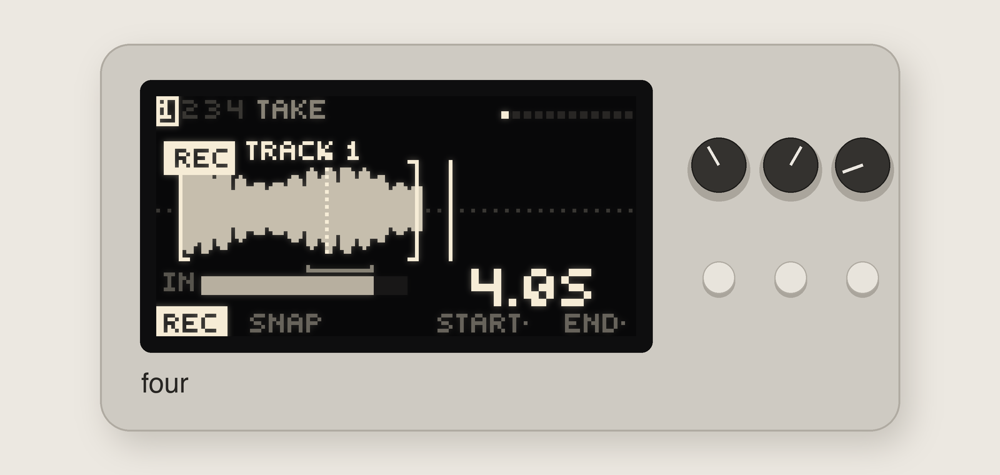

# four

A creative live sampler for [norns](https://monome.org/docs/norns/), free for everyone.
Record any sound, then loop it, stretch it and scatter it into grains on four tracks.

<!-- doc/hero.png is a placeholder picture. Replace it with the drawing. -->


## What it does

- Four tracks. Each track holds its own take of up to 60 seconds.
- Five voices play a take: PLAY (like tape), GRAIN (a cloud of grains), WARP and PV (two
  ways to stretch time without changing pitch) and CLOUD (a texture granulator).
- Each track has a filter, drive and crush, and two effects in a row: chorus, flanger,
  wobble, resonator, ring or echo.
- Each track sends to a shared delay and a shared reverb.
- Scenes keep a whole sound, and you can morph between them. MOTION records your knob
  moves and loops them, and four modulators can move the main knobs.
- Three keys and three encoders reach everything. A grid helps, but you never need one.
- Every parameter maps to MIDI.

## Install

In maiden, type this line, then select SYSTEM > RESTART:

```
;install https://github.com/Alejo-end/four
```

You need a norns and a sound at line level on its input. four is built on a norns shield
with a Raspberry Pi 4.

## First minutes

1. On TAKE, press K2, play something, then press K2 again. The take loops.
2. Turn E2 and E3 to set where the loop starts and ends.
3. Turn E1 to VOICE. Press K3 to step through the voices.
4. Turn E1 to FILTER and EFFECT, and turn them up.
5. To hear the delay and the reverb, go to TRACKS, hold K1 and open the track's sends.
6. Hold K1 and turn E1 to pick track 2. Record a second take there.
7. On SCENE, press K3 to keep the sound. Change it, then turn E3 to morph back.

Two moves work on every page. K1 + K2 stops and starts all sound. A tap of K1 + K3 turns
all effects off.

## The pages


TAKE, VOICE, TRACKS, TAPE, FILTER, EFFECT, DELAY, REVERB, MIX, PADS, MOTION and SCENE.
Turn E1 to move between them. The bottom of the screen names what K2, K3, E2 and E3 do
on each page.

## More

- [The full guide](doc/manual.md): every page with pictures, the grid, MIDI, saving and
  troubleshooting.
- [Every key and knob](doc/controls.md), generated from the code.
- Optional extras: the FourStretch plugin for richer voices
  ([ugen/README.md](ugen/README.md)), a monome grid, or a Launchpad Mini MK3.

## License

four is free software under the [GNU General Public License v3](LICENSE). You can use
it, change it and share it.
