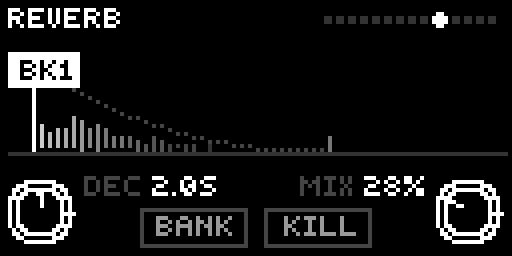
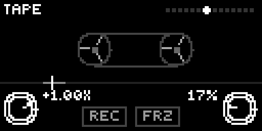
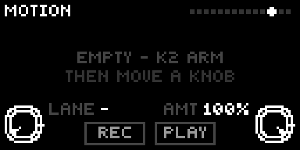
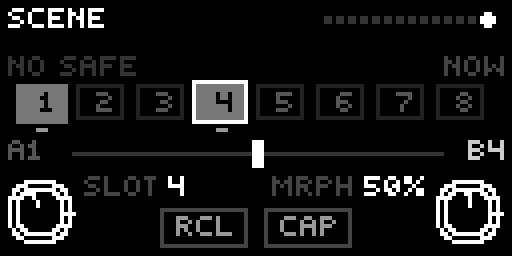

# mangler

**A live stereo sampler and mangler for [norns](https://monome.org/norns/).** (norns is a
small open sound computer from monome.) It is for anyone who wants to record live gear and
warp it on the fly: plug in a synth, a drum machine, or anything else that runs at line
level, record a phrase, and it loops straight back the way you played it. From there you can
granulate it, time-stretch it, chop it into playable slices, and run it through a filter,
delay and reverb.

You drive the whole thing with three keys and three encoders, so you never need a grid. If
you have one you can plug it in for a pad surface.


> **Status:** staged and still moving. The engine is built and tested in gated stages on real
> hardware, so features can still change between versions. See [CLAUDE.md](CLAUDE.md) for the
> current stage and the full build log.

**Contents:** [Requirements](#requirements) · [Play it in 60 seconds](#play-it-in-60-seconds) · [The pages](#the-pages) · [Controls](#controls-3-keys-3-encoders) · [Playing notes](#playing-notes) · [Install](#install) · [Under the hood](#under-the-hood)

## Requirements

- A **norns** running current software. Built and tested on a **norns shield XL on a
  Raspberry Pi 4**. Stock norns and older Pis are untested. They may work, but the CPU budget
  is tuned for the Pi 4, so treat anything else as unsupported for now.
- SuperCollider, which ships with norns and runs the engine.
- **Optional:** a MIDI controller, a grid (a monome grid, or a Launchpad / APC mini through
  [midigrid](https://github.com/miker2049/midigrid)), and two plugins for the fuller sound,
  [sc3-plugins](https://github.com/supercollider/sc3-plugins) (JPverb reverb) and
  [mi-UGens](https://github.com/v7b1/mi-UGens) (MiClouds granular). All optional, and mangler
  runs fine without any of them.

## Play it in 60 seconds

First time here? [Install](#install) takes about two minutes. Once it is on the norns:

1. Plug in your source. Go to **LEVEL** and set IN so the meters peak just below the top.
2. Record. On **REC**, tap **K2**, play a phrase, then tap **K2** again. The window snaps to
   your take and starts looping it. It plays back dry, exactly the sound you just recorded.
3. Shape it. The drone starts on **PLAY**, a clean loop of your sample. Switch to **GRAIN**,
   **WARP** or **PV** on **STRETCH** when you want to mangle it. **WINDOW** tightens the
   slice and **GRAIN** tunes the granular character.
4. Add effects when you want them. **DELAY** and **REVERB** both start at zero mix, so they
   are off. Turn E2 up on each page to dial them in.
5. Play it polyphonically. On **PADS** (press K1+K3 to switch to `NOTES>PADS`), MIDI notes
   and grid pads trigger 8 slices of your recording on top of the drone. Chop it up, or play
   chords.
6. Loop your hands. On **MOTION**, tap **K2** and move any knob — a filter sweep, a delay
   swell — then tap **K2** again. It records the *movement* and plays it back on a loop, so
   your hands are free to layer another one on top.

> **Dry by default.** A fresh recording is your sample, untouched. The filter is wide open,
> drive is a true bypass at zero, and delay and reverb stay silent until you turn them up.
> You build the sound by adding to it, never by taking away what was already there.

Longer walkthroughs: [standalone](doc/workflow-standalone.md) and [with a grid](doc/workflow-grid.md).

## The pages

You do not need to learn all of these to start. The quickstart above uses a handful of them.
This is the reference for when you want the rest.

Every frame below is real output, drawn by the offscreen renderer in `tools/uisim/` over a
scripted take. The layout is the same on every page: a small title that never disappears, the
armed-status flags next to it, page dots in the top right, and a footer that mirrors the
panel. The footer shows the two knobs (they fill in solid while you turn them), the live
E2/E3 values, and the K2/K3 pills.


| | |
|---|---|
| <br>**REC** shows the buffer with the write head laying down material. When it is empty it says `EMPTY - K2 REC`. Turn up **regen** (E3 + K1) and the loop feeds on its own processed output — a slow self-resampling decay, the sampler mangling itself. | <br>**MIX** crossfades the engine against the tape deck. |
| <br>**GRAIN** is the granular editor. The drawing is whatever Clouds mode you pick with K3: GRANULAR cloud, STRETCH windows, LOOP with echoes, or SPECTRAL columns. K2 banks the params. | <br>**LEVEL** has stereo I/O meters with peak-hold and clip lamps. |
| <br>**FILTER** draws the engine's real LP/HP/BP response, with a node dot at the cutoff. | <br>**REVERB** shows the decay tail: an onset, then reflections dying off over time, with the tail length tracking the decay. K2 banks the full JPverb controls, including shimmer, which pitch-shifts the feedback into a rising octave halo. |
| <br>**DELAY** draws one bounce per repeat, and the arcs shrink as feedback rises. Starts dry. | <br>**TAPE** is a parallel loop deck. The reels spin at the real playback rate. |
| <br>**PADS** shows your recording up top split into 8 slices, with 8 pad buttons below, one per slice (GRN for a cloud, SLC for a slice, lit while sounding, with a cursor). The header reads `PLAY>PADS` or `PLAY>DRONE` (toggle with K1+K3). | <br>**STRETCH** picks the drone engine: PLAY (a clean loop, the default), GRAIN, WARP or PV. Each one draws its own texture, and goes flat when it is off. |
| <br>**MOTION** is the gesture looper. K2 arms it, and then any knob you move is recorded into a loop that plays your hands back — one lane per parameter. K2 again overdubs another move on top; K3 stops and starts playback. It records the moves, not the audio, so it costs nothing extra to run. | **A modulation loop pedal.** Record a slow filter sweep and it loops hands-free while you granulate over it; layer a delay swell on a second lane. E2 browses the lanes, E3 is a global amount, K1+K2 clears the selected lane, K1+K3 wipes all of them. `motion record` and `motion play` are MIDI-mappable, so a footswitch can punch overdubs. |
| <br>**SEQ** is a Euclidean step sequencer (up to 16 steps) that retriggers your slices on the clock. Turn E2 to set the number of hits and it distributes them evenly; K2 runs it, K3 picks which slice fires. | **Rhythm from a knob.** One dial (Euclidean hits) turns a slice into a beat — 5 hits over 16 gives you a clave-ish pattern for free. E3 sets the length, K1+E3 the division (8th/16th/32nd), K1+E2 the tempo. `seq play` is MIDI-mappable. Per-step pitch, patterns and grid editing are on the way. |
| <br>**SCENE** remembers whole sounds. K3 captures the current one into the selected slot, K2 recalls it (now, or on the next beat/bar). E3 **morphs** between two slots — one knob walks the whole instrument from A to B. | **The ways back.** K1+K3 marks a **SAFE** state, K1+K2 **UNDO**s back to it — so you can throw the thing off a cliff and be home in one press. Map `chaos throw` to a footswitch: hold for bounded mayhem, release to land safe. Scenes save with your PSET. |

## Controls: 3 keys, 3 encoders

| | |
|---|---|
| **E1** | Select the page. Hold K1 to jump between page families. |
| **E2 / E3** | The page's two knobs. Value and dial live in the footer. Hold K1 for the alt pair. |
| **K1** (hold) | Alt / shift. |
| **K2 / K3** | The page's two actions. The footer pills invert while they are active. |
| **K1+K2** | STOP / START. Mutes everything (a `STP` flag blinks by the title), press again and the exact mix comes back. Works on every page except GRAIN, TAPE, PADS, MOTION and SCENE, where alt-K2 has a page job — the footer pill shows which you have while K1 is held. Also on the space bar of a USB keyboard, grid pad (8,2), and MIDI-mappable as `stop all`. |
| **K1+K3** | DRY. One press throws the playback path clean — delay, reverb, shimmer, drive and clouds feedback to zero, filter open — so you hear the bare sample. Works everywhere except GRAIN, TAPE, REVERB, PADS, MOTION and SCENE. Also grid pad (7,2). |

The pages are MIX, LEVEL, REC, WINDOW, GRAIN, STRETCH, TAPE, FILTER, DELAY, REVERB, PADS,
MOTION, SEQ and SCENE. The pages with a lot of controls (REVERB, GRAIN) are banked, so K2 pages
E2/E3 through the parameter pairs. The full page-to-control map is in `doc/spec.md` §10.

## Playing notes

A MIDI keyboard retunes the sample chromatically. Note 60 plays it as recorded, and you get
±24 semitones with the pitch staying independent of the speed. A USB typing keyboard works
Ableton-style: the A row plays white keys, the W row plays black keys, and Z/X shift the
octave. Turn pad input on and the notes trigger the 8 PADS slices polyphonically instead. The
settings are in **PARAMS > keys**.

**MIDI mapping.** Every continuous and toggle parameter can be mapped. Long-press it in
**PARAMS** and assign a CC. Your mappings save per script to `data/mangler/mangler.pmap` and
reload automatically.

**Grid (optional).** You don't need a grid, but you can plug one in. A monome grid works
as-is, and a Launchpad or APC mini works through the
[midigrid](https://github.com/miker2049/midigrid) library. Either way you get an 8×8 surface
with transport and mode toggles, two-finger slice and loop selection, and two piano octaves.
The pads drive the same params as everything else.

## Install

**First time?** Copy the folder onto your norns and restart. That is the whole install:

```sh
rsync -av --delete --exclude='.git' ./ we@norns.local:~/dust/code/mangler/
```

Replace `we@norns.local` with your norns. `we` is the default norns user, and `norns.local`
is the default hostname. If that name does not resolve, use the IP address instead (you can
read it on the device under SYSTEM > WIFI), for example
`we@192.168.1.23:~/dust/code/mangler/`.

Then load it. Open **maiden** (the norns web editor, at `http://norns.local/` or
`http://<your-norns-ip>/` in a browser) and type `;restart` in the REPL at the bottom, or
just pick **mangler** from the SELECT menu on the device itself.

**Why `--delete` matters:** it clears out any stale copy of the engine. A leftover engine file
would otherwise hang every script on "LOADING", so it is worth keeping. A private repo is
fine, since rsync copies over your local network and GitHub is never involved.

**Single-file drop-in.** `dist/mangler_single.lua` is the whole control layer amalgamated into
one file (generated by `lua tools/amalgamate.lua` and byte-checked against the modules, so
edit the modules, not this file). You still need the engine `lib/Engine_Mangler.sc` present,
and exactly once anywhere on the device.

**For the best sound**, install the two optional plugins from
[Requirements](#requirements): [sc3-plugins](https://github.com/supercollider/sc3-plugins) for
JPverb, and [mi-UGens](https://github.com/v7b1/mi-UGens) for MiClouds. Both are fully guarded:
if a plugin is missing, mangler falls back to stock SuperCollider (FreeVerb or GrainBuf) and
loads normally. Nothing can brick loading.

## Under the hood

**Performance on the Pi 4.** scsynth runs on a single core and starts to xrun past about 60%,
so softcut (a separate, near-free core) handles the tape: record, loop, varispeed and
reverse. scsynth only does what softcut can't, which is the granular, the stretch and the
custom FX. The three drone algorithms are one voice with a mode switch, so you never pay for
all of them at once.

**Params are the single source of truth.** Keys, encoders, MIDI and the grid all drive the
same `params:*`, so they stay in lockstep. This is also why every parameter is MIDI-mappable
for free.

**Staged and gated.** The engine grows in stages, each one tested on the device before the
next. The current stage and the full build log are at the top of [CLAUDE.md](CLAUDE.md), and
the durable design lives in [doc/spec.md](doc/spec.md).

```
mangler.lua              orchestrator: state, params, keys and encoders
lib/Engine_Mangler.sc    the one and only SuperCollider engine
lib/mpages.lua           the screen: page bodies, header and footer
lib/mtape.lua            softcut tape path and the engine/tape mix
lib/minput.lua           MIDI and typing-keyboard note input
lib/mgrid.lua            optional grid surface
lib/mmotion.lua          gesture looper: records and replays the param stream
lib/mseq.lua             Euclidean step sequencer driving the slice voices
lib/mfont.lua  lib/mparticles.lua   pixel font and pooled grain particles
tools/uisim/             offscreen UI renderer, every page as a PNG, no hardware
dist/mangler_single.lua  generated single-file drop-in
```

## License

No license has been chosen yet, so for now the code is all rights reserved by default. If you
want to build on it, ask.
