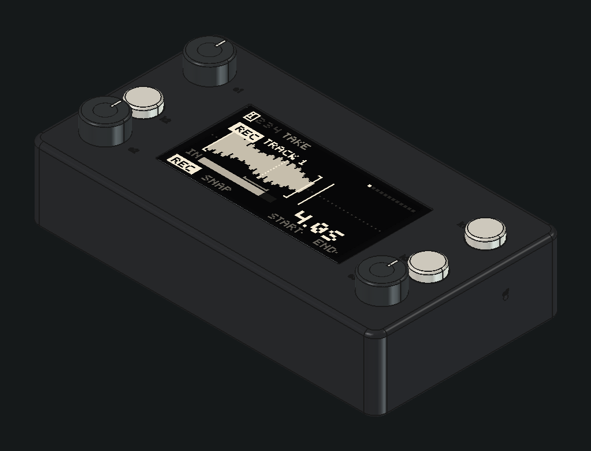

# four

four is a live sampler for [norns](https://monome.org/docs/norns/) with four stereo tracks.
Catch what your synth or drum machine plays, and the recording turns into a new instrument
in your hands.



*A render of a pocket-sized version of the norns shield, with four on its screen. It is
built around a Raspberry Pi Compute Module 4 and is still in design.*

## What it does

Anything at line level goes in: a synth, a drum machine, a tape deck, another norns. Each
of the four tracks records its own take of up to 60 seconds, loops it and plays it through
its own chain:

- A voice. PLAY runs the take like tape, with varispeed. GRAIN turns it into a granular
  cloud. WARP and PV stretch time without changing the pitch. CLOUD is a second
  granulator, made for texture.
- A filter (low-pass, high-pass or band-pass) with drive and crush.
- Two effects in series: chorus, flanger, wobble, resonator, ring modulator or echo.
- Sends into a shared delay and a shared reverb.

Around the tracks sit a tape loop deck for the input or the whole mix, and eight pads that
slice a take. A step sequencer plays the pads. Scenes hold a whole sound, and one knob
morphs from one scene to the next. MOTION loops your knob moves, and four modulators sway
the sound around your settings. Three keys and three encoders reach everything. A grid is
optional, and every parameter maps to MIDI.

## Install

In maiden, type this line, then select SYSTEM > RESTART:

```
;install https://github.com/Alejo-end/four
```

You need a norns and a sound at line level on its input. four is built on a norns shield
with a Raspberry Pi 4.

## First minutes

1. On TAKE, press K2, play something, then press K2 again. The take loops.
2. Turn E2 and E3 to set where the loop starts and ends.
3. Turn E1 to VOICE. Press K3 to step through the voices.
4. Turn E1 to FILTER and EFFECT, and turn them up.
5. To hear the delay and the reverb, go to TRACKS, hold K1 and open the track's sends.
6. Hold K1 and turn E1 to pick track 2. Record a second take there.
7. On SCENE, press K3 to keep the sound. Change it, then turn E3 to morph back.

Two moves work on every page. K1 + K2 stops and starts all sound. A tap of K1 + K3 turns
all effects off.

## The pages


TAKE, VOICE, TRACKS, TAPE, FILTER, EFFECT, DELAY, REVERB, MIX, PADS, MOTION and SCENE.
Turn E1 to move between them. The bottom of the screen names what K2, K3, E2 and E3 do
on each page.

## More

- [The full guide](doc/manual.md): every page with pictures, the grid, MIDI, saving and
  troubleshooting.
- [Every key and knob](doc/controls.md), generated from the code.
- Optional extras: the FourStretch plugin for richer voices
  ([ugen/README.md](ugen/README.md)), a monome grid, or a Launchpad Mini MK3.

## License

four is free software under the [GNU General Public License v3](LICENSE). You can use
it, change it and share it.
