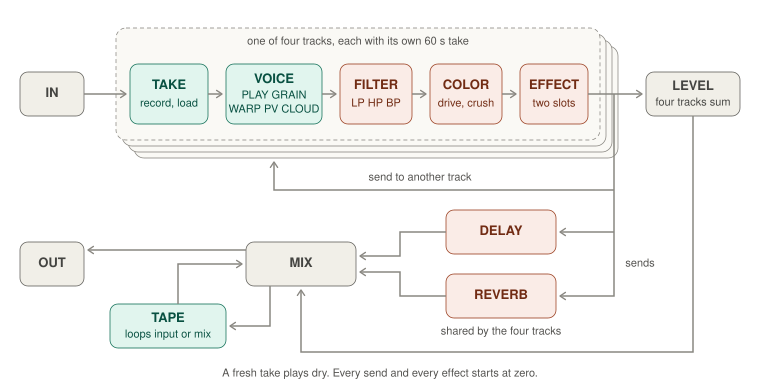
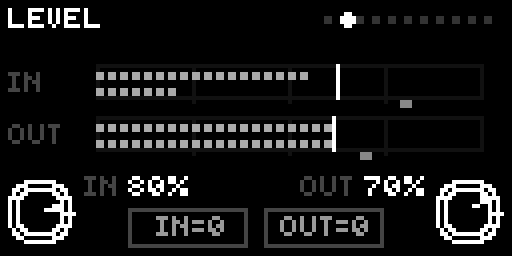
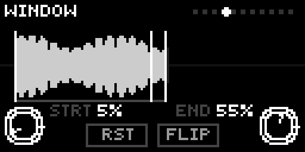
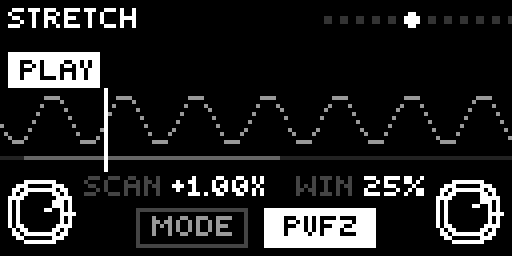
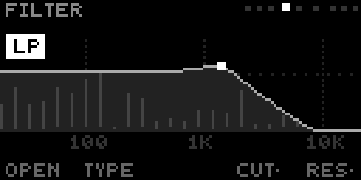
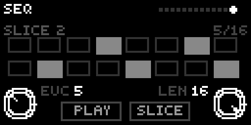

# mangler

**A live stereo sampler and mangler for [norns](https://monome.org/norns/).** (norns is a
small open sound computer from monome.) It is for anyone who wants to record live gear and
warp it on the fly: plug in a synth, a drum machine, or anything else that runs at line
level, record a phrase, and it loops straight back the way you played it. From there you can
granulate it, time-stretch it, chop it into playable slices, and run it through a filter,
delay and reverb.

You drive the whole thing with three keys and three encoders, so you never need a grid. If
you have one you can plug it in for a pad surface.



> **Status:** staged and still moving. The engine is built and tested in gated stages on real
> hardware, so features can still change between versions. See [CLAUDE.md](CLAUDE.md) for the
> current stage and the full build log.

**Contents:** [Requirements](#requirements) · [Play it in 60 seconds](#play-it-in-60-seconds) · [Controls](#controls-3-keys-3-encoders) · [The pages](#the-pages) · [Playing notes](#playing-notes) · [Install](#install) · [Under the hood](#under-the-hood)

## Requirements

- A **norns** running current software. Built and tested on a **norns shield XL on a
  Raspberry Pi 4**. Stock norns and older Pis are untested. They may work, but the CPU budget
  is tuned for the Pi 4, so treat anything else as unsupported for now.
- SuperCollider, which ships with norns and runs the engine.
- **Optional:** a MIDI controller, a grid (a monome grid, or a Launchpad / APC mini through
  [midigrid](https://github.com/miker2049/midigrid)), and two plugins for the fuller sound,
  [sc3-plugins](https://github.com/supercollider/sc3-plugins) (JPverb reverb) and
  [mi-UGens](https://github.com/v7b1/mi-UGens) (MiClouds granular). All optional, and mangler
  runs fine without any of them.

## Play it in 60 seconds

First time here? [Install](#install) takes about two minutes. Once it is on the norns:

1. Plug in your source. Go to **LEVEL** and set IN so the meters peak just below the top.
2. Record. On **REC**, tap **K2**, play a phrase, then tap **K2** again. The window snaps to
   your take and starts looping it. It plays back dry, exactly the sound you just recorded.
3. Shape it. The drone starts on **PLAY**, a clean loop of your sample. Switch to **GRAIN**,
   **WARP** or **PV** on **STRETCH** when you want to mangle it. **WINDOW** tightens the
   slice and **GRAIN** tunes the granular character.
4. Add effects when you want them. **DELAY** and **REVERB** both start at zero mix, so they
   are off. Turn E2 up on each page to dial them in.
5. Play it polyphonically. On **PADS** (press K1+K3 so the header reads `PLAY>PADS`), MIDI
   notes and grid pads trigger 8 slices of your recording on top of the drone. Chop it up, or
   play chords.
6. Loop your hands. On **MOTION**, tap **K2** and move any knob — a filter sweep, a delay
   swell — then tap **K2** again. It records the *movement* and plays it back on a loop, so
   your hands are free to layer another one on top.

> **Dry by default.** A fresh recording is your sample, untouched. The filter is wide open,
> drive is a true bypass at zero, and delay and reverb stay silent until you turn them up.
> You build the sound by adding to it, never by taking away what was already there.

Longer walkthroughs: [standalone](doc/workflow-standalone.md) and [with a grid](doc/workflow-grid.md).

## Controls: 3 keys, 3 encoders

Everything is these six controls. Learn this once and every page reads the same way.

| | |
|---|---|
| **E1** | Select the page. Hold K1 to jump between page families. |
| **E2 / E3** | The page's two knobs. Value and dial live in the footer. Hold K1 for the alt pair. |
| **K1** (hold) | Alt / shift. Nothing happens on its own — hold it to reach the second layer of the knobs and keys. The footer shows you what you have while it's down. |
| **K2 / K3** | The page's two actions. The footer pills invert while they are active. |
| **K1+K2** | STOP / START. Mutes everything (a `STP` flag blinks by the title), press again and the exact mix comes back. Works on every page except GRAIN, TAPE, PADS, MOTION and SCENE, where alt-K2 has a page job — the footer pill shows which you have while K1 is held. Also on the space bar of a USB keyboard, grid pad (8,2), and MIDI-mappable as `stop all`. |
| **K1+K3** | DRY. One press throws the playback path clean — delay, reverb, shimmer, drive and clouds feedback to zero, filter open — so you hear the bare sample. Works everywhere except GRAIN, TAPE, REVERB, PADS, MOTION and SCENE. Also grid pad (7,2). |

**The footer mirrors your hands.** Left dial = E2, right dial = E3, and the two pills between
them are K2 and K3. A dial fills in solid while you're turning that knob. Hold K1 and all four
change to the alt layer, so you can always see what the second layer does before you commit.

Two pages have more controls than four knobs (**REVERB**, **GRAIN**), so they are *banked*: K2
pages E2/E3 — and their alt pair — through the parameters, and a `BK n` chip shows where you are.

## The pages

You do not need to learn these to start — the quickstart above uses a handful. This is the
manual for the rest. Every frame is real output from the offscreen renderer in `tools/uisim/`,
drawn over a scripted take.

E1 walks the pages in this order. Hold K1 and turn E1 to jump between the families.

| # | page | what it's for | family |
|---|---|---|---|
| 1 | [MIX](#mix) | balance the engine against the tape deck | source |
| 2 | [LEVEL](#level) | set your levels — **start here** | source |
| 3 | [REC](#rec) | record a phrase | source |
| 4 | [WINDOW](#window) | choose which part of the take loops | shape |
| 5 | [GRAIN](#grain) | granular character | shape |
| 6 | [STRETCH](#stretch) | pick the engine that plays your loop | shape |
| 7 | [TAPE](#tape) | a second, parallel loop deck | tape |
| 8 | [FILTER](#filter) | tone | fx |
| 9 | [DELAY](#delay) | echoes | fx |
| 10 | [REVERB](#reverb) | space, and shimmer | fx |
| 11 | [PADS](#pads) | play your take as 8 slices | fx |
| 12 | [MOTION](#motion) | record and replay your knob moves | motion |
| 13 | [SEQ](#seq) | a Euclidean step sequencer | seq |
| 14 | [SCENE](#scene) | store, recall and morph whole sounds | scene |

Every knob below is also a parameter in **PARAMS**, where you can MIDI-map it. The same map in
one terse table (for anyone reading the code) is `doc/spec.md` §10.

### MIX


Blends the **engine** (the drone and the pads) against the **tape deck**. Each lane only shows
energy when that deck is actually audible, so the picture tells you what you're hearing.

- **E2** engine ↔ tape crossfade · **K1+E2** master out level
- **E3** engine level · **K1+E3** tape level
- **K2** throw all the way to ENG · **K3** throw all the way to TAPE

### LEVEL



Stereo meters for what's coming in and what's going out, with peak-hold pips and clip lamps.
**Start here:** set IN so the meters peak just below the top.

- **E2** input · **K1+E2** monitor (your input passed straight through to the output)
- **E3** output · **K1+E3** headphones
- **K2** IN to unity (0 dB) · **K3** OUT to unity

### REC


The 60-second buffer, with the write head laying material down as it captures. **K2, play a
phrase, K2** — the window snaps to what you just played and loops it, dry. Empty, it says
`EMPTY - K2 REC`.

- **E2** rec level · **K1+E2** overdub — how much of the old take survives underneath the new one
- **E3** resample — bakes the processed output into the take while you record · **K1+E3** regen —
  the buffer slowly re-records its own output, a self-mangling decay (`REGN` lights while it runs)
- **K2** arm / stop · **K3** freeze — nothing more gets written, whatever the transport does

### WINDOW



The take with handles on it: this is the region the drone loops, and it's what everything
downstream slices — the pads and the sequencer both work inside it. Recording sets it for you;
tighten it by hand for a stutter.

- **E2** window start · **K1+E2** scan rate — playback speed and direction
- **E3** window end · **K1+E3** jitter — scatters the playhead around the window
- **K2** reset to the whole buffer · **K3** FLIP — negate the scan and play it backwards

The edges get finer as the window tightens, so a wide window moves fast and a tight loop nudges
by milliseconds.

### GRAIN


The granular editor, and the drawing *is* the mode you pick with K3: a cloud of grains
(GRANULAR), overlapping windows (STRETCH), a loop with echo ghosts (LOOP), or spectral columns
(SPECTRAL).

**These knobs feed the GRAIN drone** — if the drone is on PLAY (the default), switch it to GRAIN
on [STRETCH](#stretch) or you won't hear them.

- **Bank 1** — **E2** grain size · **K1+E2** spread (stereo width) · **E3** density (grains per
  second) · **K1+E3** texture
- **Bank 2** — **E2** grain position · **K1+E2** grain level · **E3** feedback · **K1+E3** lofi
- **K2** BANK — page the knobs · **K3** MODE — cycle the four modes
- **K1+K2** octave down · **K1+K3** octave up

Texture, position, feedback, lofi and the modes are **MiClouds** controls: with mi-UGens
installed you get the Clouds granular voice, and without it the stock grain cloud, where those
four do nothing. Size, density, spread and pitch work either way.

### STRETCH



Picks the engine that plays your loop. Each one draws its own texture, and lies flat when it's
off.

- **PLAY** — a clean loop, exactly as recorded. The default.
- **GRAIN** — granular clouds, tuned on [GRAIN](#grain).
- **WARP** — time-stretch: scan sets the speed, pitch stays independent of it.
- **PV** — a phase vocoder. K3 freezes the spectrum into a pad.
- **OFF** — silences the drone. The pads, the sequencer and the tape still play.

- **E2** scan rate · **K1+E2** pitch — ±2 octaves, independent of speed
- **E3** warp window · **K1+E3** warp randomisation
- **K2** cycle the mode · **K3** PV freeze

### TAPE


A second deck running in parallel: it records straight from your input, independent of the
engine, and loops it. The reels spin at the real playback rate. **Hear it by turning the
[MIX](#mix) crossfade toward TAPE.**

- **E2** tape rate — negative plays it backwards · **K1+E2** overdub
- **E3** loop start · **K1+E3** loop end
- **K2** record · **K3** freeze the loop · **K1+K2** reverse while held · **K1+K3** clear the tape

It runs on softcut, a separate audio core, so it costs the engine almost nothing.

### FILTER



The engine's real response curve, with a bright node at the cutoff. Wide open by default.

- **E2** cutoff · **K1+E2** dry/wet — the engine's own wet path
- **E3** resonance · **K1+E3** grain level
- **K2** cycle LP / HP / BP · **K3** OPEN — throw it wide open and kill the resonance

### DELAY


One bouncing arc per repeat; the arcs shrink as the feedback rises. Starts dry.

- **E2** delay mix · **K1+E2** time
- **E3** feedback · **K1+E3** drive — post-filter saturation, a true bypass at zero
- **K2** INF — feedback to 0.95, the dub pile-up · **K3** KILL — feedback to zero

### REVERB


The decay tail drawn the way it sounds: an onset spike, then reflections dying away. The tail
grows with the decay. Starts dry.

- **Bank 1 · SPACE** — **E2** decay · **K1+E2** damping · **E3** mix · **K1+E3** size
- **Bank 2 · TONE** — **E2** low decay · **K1+E2** high decay · **E3** mid decay · **K1+E3**
  early diffusion
- **Bank 3 · MOD** — **E2** mod depth · **K1+E2** low crossover · **E3** mod rate · **K1+E3**
  high crossover
- **Bank 4 · SHIMMER** — **E2** shimmer · **K1+E2** shimmer tone · **E3** shimmer pitch ·
  **K1+E3** mix
- **K2** BANK · **K3** KILL — mix to zero · **K1+K3** SHMR — bloom the shimmer on and off

Shimmer pitch-shifts the reverb's own feedback, so the tail climbs in octaves into a pad. With
sc3-plugins installed this is the full JPverb; without it you get stock FreeVerb, which responds
to decay, damping and mix only — the other nine knobs do nothing.

### PADS


Your take, chopped into 8 playable slices. The strip up top is the take; the 8 buttons below are
the pads, one per slice, sitting under the slice they play. `GRN` plays its slice as a grain
cloud, `SLC` plays it clean. They sound **polyphonically, on top of the drone**.

Press **K1+K3** so the header reads `PLAY>PADS`, and MIDI notes and grid pads play the slices
instead of retuning the drone. The slices follow the [window](#window), so re-record and the pads
move with the new take.

- **E2** poly voices (1–16) · **K1+E2** attack
- **E3** release — shorten it for tight, percussive hits
- **K2** move the cursor · **K3** flip the cursor pad GRN/SLC · **K1+K2** audition it while held ·
  **K1+K3** route notes to the pads or back to the drone

### MOTION


**A loop pedal for your hands.** It records the *movement* of your knobs — not audio — and plays
it back on a loop, so a slow filter sweep keeps going while you do something else.

**K2**, move a knob, **K2**. That move now loops. Move a different knob and it becomes a second
lane, layered on the first. Each parameter gets its own lane, and re-recording one replaces only
that lane.

- **E2** browse the lanes · **E3** amount — scales every lane back toward where it started
- **K2** arm / finish (arming again overdubs onto the running loop) · **K3** play / stop
- **K1+K2** clear the selected lane · **K1+K3** wipe all of them

`motion record` and `motion play` are MIDI-mappable, so a footswitch can punch overdubs in
hands-free.

### SEQ



**Rhythm from one knob.** Turn **E2** and it spreads that many hits as evenly as it can across the
pattern — 5 over 16 gives you a clave for free. Every hit retriggers one slice of your take, on
the clock, over the drone.

- **E2** hits · **K1+E2** tempo (the system clock)
- **E3** length, up to 16 steps · **K1+E3** division — 8th / 16th / 32nd notes
- **K2** run / stop · **K3** pick which slice fires

To hear the steps distinctly, drop the drone (STRETCH → OFF) or shorten the pad release.

**With a grid**, the SEQ page turns the whole grid into the sequencer: rows 1–2 are the 16 steps
(tap one to toggle it), row 7 picks the slice, row 8 is play and clear. Euclid is the generator
and your taps edit on top of it — set hits to 0 and draw a pattern by hand.

### SCENE


**Eight slots that remember the whole sound** — every mangle knob at once, not the audio. **K3**
captures what you're hearing into the selected slot; **K2** recalls it, right away or on the next
beat or bar (`PARAMS > scenes > recall quantize`).

**E3 morphs.** Pick two slots as A and B, and that one knob walks the entire instrument between
them — filter, grain, stretch, FX, all moving together. Holds like freeze, the note routing and
the buffer-writers deliberately don't ride a morph, so the page says `RCL B TO LAND` when a
recall is needed to finish the trip.

**The ways back.** **K1+K3** marks the current sound as **SAFE**; **K1+K2** is **UNDO** — it puts
you straight back on it. Mark a state, do something reckless, come home in one press.

- **E2** slot · **K1+E2** morph A
- **E3** morph amount · **K1+E3** morph B
- **K2** recall · **K3** capture · **K1+K2** UNDO to safe · **K1+K3** mark safe

Map `chaos throw` to a footswitch: **hold** it for a bounded random throw, **release** and you
land back on your safe state. Scenes save and load with your PSET.

**With a grid**, the SCENE page becomes the bank: row 1 is the 8 slots (tap to recall, or hold
CAP / CLR on row 8 and tap to capture or clear), rows 3 and 4 pick A and B, row 6 is an 8-step
morph bar, and row 8 carries CAP, CLR, CHAOS, SAFE and UNDO.

## Playing notes

A MIDI keyboard retunes the sample chromatically. Note 60 plays it as recorded, and you get
±24 semitones with the pitch staying independent of the speed. A USB typing keyboard works
Ableton-style: the A row plays white keys, the W row plays black keys, and Z/X shift the
octave. Turn pad input on and the notes trigger the 8 PADS slices polyphonically instead. The
settings are in **PARAMS > keys**.

**MIDI mapping.** Every continuous and toggle parameter can be mapped. Long-press it in
**PARAMS** and assign a CC. Your mappings save per script to `data/mangler/mangler.pmap` and
reload automatically.

**Grid (optional).** You don't need a grid, but you can plug one in. A monome grid works
as-is, and a Launchpad or APC mini works through the
[midigrid](https://github.com/miker2049/midigrid) library. Either way you get an 8×8 surface
with transport and mode toggles, two-finger slice and loop selection, and two piano octaves.
The pads drive the same params as everything else.

## Install

**First time?** Copy the folder onto your norns and restart. That is the whole install:

```sh
rsync -av --delete --exclude='.git' ./ we@norns.local:~/dust/code/mangler/
```

Replace `we@norns.local` with your norns. `we` is the default norns user, and `norns.local`
is the default hostname. If that name does not resolve, use the IP address instead (you can
read it on the device under SYSTEM > WIFI), for example
`we@192.168.1.23:~/dust/code/mangler/`.

Then load it. Open **maiden** (the norns web editor, at `http://norns.local/` or
`http://<your-norns-ip>/` in a browser) and type `;restart` in the REPL at the bottom, or
just pick **mangler** from the SELECT menu on the device itself.

**Why `--delete` matters:** it clears out any stale copy of the engine. A leftover engine file
would otherwise hang every script on "LOADING", so it is worth keeping. A private repo is
fine, since rsync copies over your local network and GitHub is never involved.

**Single-file drop-in.** `dist/mangler_single.lua` is the whole control layer amalgamated into
one file (generated by `lua tools/amalgamate.lua` and byte-checked against the modules, so
edit the modules, not this file). You still need the engine `lib/Engine_Mangler.sc` present,
and exactly once anywhere on the device.

**For the best sound**, install the two optional plugins from
[Requirements](#requirements): [sc3-plugins](https://github.com/supercollider/sc3-plugins) for
JPverb, and [mi-UGens](https://github.com/v7b1/mi-UGens) for MiClouds. Both are fully guarded:
if a plugin is missing, mangler falls back to stock SuperCollider (FreeVerb or GrainBuf) and
loads normally. Nothing can brick loading.

## Under the hood

**Performance on the Pi 4.** scsynth runs on a single core and starts to xrun past about 60%,
so softcut (a separate, near-free core) handles the tape: record, loop, varispeed and
reverse. scsynth only does what softcut can't, which is the granular, the stretch and the
custom FX. The three drone algorithms are one voice with a mode switch, so you never pay for
all of them at once.

**Params are the single source of truth.** Keys, encoders, MIDI and the grid all drive the
same `params:*`, so they stay in lockstep. This is also why every parameter is MIDI-mappable
for free.

**Staged and gated.** The engine grows in stages, each one tested on the device before the
next. The current stage and the full build log are at the top of [CLAUDE.md](CLAUDE.md), and
the durable design lives in [doc/spec.md](doc/spec.md).

```
mangler.lua              orchestrator: state, params, keys and encoders
lib/Engine_Mangler.sc    the one and only SuperCollider engine
lib/mpages.lua           the screen: page bodies, header and footer
lib/mtape.lua            softcut tape path and the engine/tape mix
lib/minput.lua           MIDI and typing-keyboard note input
lib/mgrid.lua            optional grid surface
lib/mmotion.lua          gesture looper: records and replays the param stream
lib/mseq.lua             Euclidean step sequencer driving the slice voices
lib/mfont.lua  lib/mparticles.lua   pixel font and pooled grain particles
tools/uisim/             offscreen UI renderer, every page as a PNG, no hardware
dist/mangler_single.lua  generated single-file drop-in
```

## License

No license has been chosen yet, so for now the code is all rights reserved by default. If you
want to build on it, ask.
