# four: the full guide

four is a four-track live sampler for [norns](https://monome.org/docs/norns/). The
[README](../README.md) is the short version. This guide has every page, its pictures and
the details.

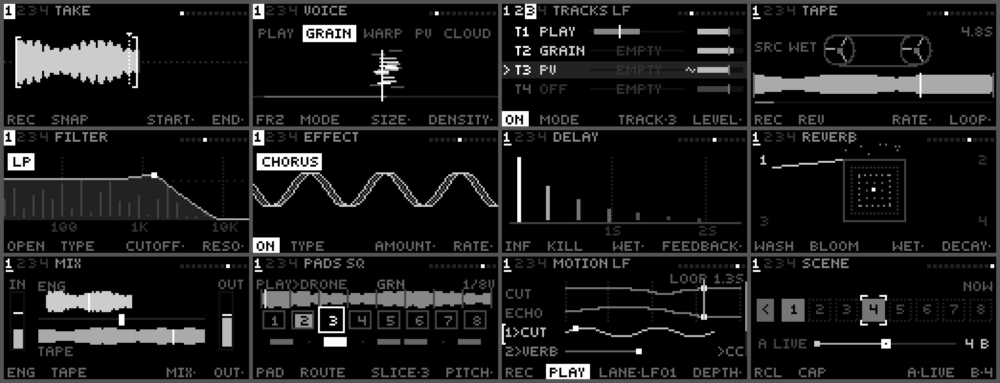

Each track has its own take of up to 60 seconds, its own voice, filter, colour and two
effects. A track can send to the other tracks, to the delay and to the reverb. Three keys
and three encoders reach everything. A grid is welcome and never needed. Every parameter
maps to MIDI.

four is in active development. It is built, measured and played on a norns shield with a
Raspberry Pi 4.

## Requirements

- A norns with current software. four is tested on a norns shield with a Raspberry Pi 4.
  The README lists what is not tested yet.
- A sound at line level on the norns input.
- Optional: a MIDI controller, a USB typing keyboard, a crow.
- Optional: a grid. A monome grid and a Launchpad Mini MK3 work directly. Other Launchpad
  and APC models work through [midigrid](https://github.com/jaggednz/midigrid).

four needs nothing else. It ships its own plugin, and it uses JPverb (sc3-plugins) when
it is there. Without the plugin, four plays stock versions of its voices and effects, and
CLOUD uses MiClouds (mi-UGens) if it is installed, or else GRAIN.

## Install

In maiden, type this line:

```
;install https://github.com/Alejo-end/four
```

Then do SYSTEM > RESTART and pick four in SELECT.

The `FourStretch` plugin holds the instrument's own stretch, grain, delay, reverb and
Clouds code. The repo ships it, built on a norns shield with a Raspberry Pi 4, in
`ignore/plugins/`, and it installs itself while the norns starts: the SYSTEM > RESTART
after `;install` puts it in place, and the log says
`four: installed the FourStretch plugin at startup`. When four loads, the SuperCollider
log says `four: FourStretch on` and `four: CLOUD is FourCloud`. If four's screen says
`PLUGIN INSTALLED / SYSTEM > RESTART`, four installed it at load instead (after an update
without a restart): do the restart, and until then four plays its stock voices. To build
the plugin yourself, see [ugen/README.md](../ugen/README.md).

## First session

1. Plug in your gear. On TAKE, press K2, play a phrase and press K2 again. The take loops
   back dry. The small diamond beside the title means that you hear the recording exactly.
2. Turn E2 and E3 to move the edges of the loop.
3. Turn E1 to VOICE. K3 steps through PLAY, GRAIN, WARP, PV and CLOUD. The picture is the
   voice's own mechanism.
4. FILTER and EFFECT start at zero. Turn them up.
5. DELAY and REVERB are silent until a track sends to them. On TRACKS, hold K1 and open
   the send D or R of the track.
6. Hold K1 and turn E1 to pick track 2. TAKE now records into track 2. TRACKS shows the
   four tracks together.
7. On SCENE, K3 keeps the whole sound in a slot. Change everything, then hold K1 and turn
   E3 to fade toward the stored scene.
8. Two moves work on every page. K1 plus K2 stops and starts all sound. A tap of K1 plus
   K3 turns all effects off.

| | |
|---|---|
| 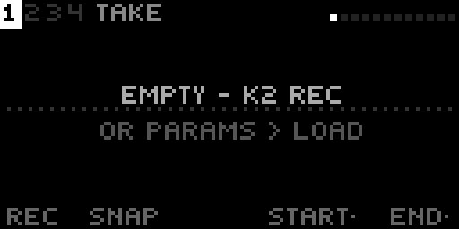 | 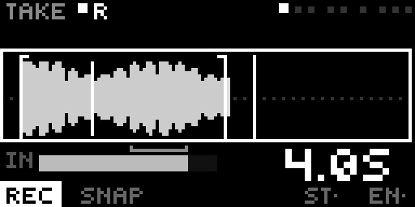 |
| An empty track asks for a take. | K2 records. The bar shows the input level. |

## Controls

Every key follows one rule. A tap turns the key on, and it stays on. A longer hold keeps it
on only while you hold. A press on a key that is on turns it off.

| Control | Action |
|---|---|
| E1 | Change the page. The name of the page shows large for a moment. |
| E2, E3 | The two knobs of the page. The value shows while you turn. |
| K1 | Hold for the second pair of knobs. |
| K2, K3 | The two keys of the page. The foot of the screen names them. |
| K1 + E1 | Pick track 1 to 4. |
| K1 + K2 | Stop or start everything. Every head resumes in its place. |
| K1 + K3 | Tap: all effects off. Hold for a second: erase what the page holds. |

[doc/controls.md](controls.md) holds the full map of each page. It is generated from
the code.

## Pages

| Page | What it does | K2 | K3 |
|---|---|---|---|
| TAKE | Record a sound and set its loop | record | snap the loop, hold: undo |
| VOICE | How the track plays the take | freeze (heal in PLAY) | next voice |
| TRACKS | The four tracks: on, level and sends | track on | next voice |
| TAPE | A loop deck that records what four plays, or the input alone | record | reverse |
| FILTER | Low-pass, high-pass or band-pass, with drive and crush | open | type |
| EFFECT | Two effects in series for the track | on | type |
| DELAY | The echoes of the tracks that send to it | hold forever | kill |
| REVERB | A room for the tracks that send to it | wash | bloom |
| MIX | Input, engine, tape and output levels | throw the engine | throw the tape |
| PADS | The take as eight slices to play | play the slice | route notes |
| MOTION | Record knob moves, and set the four modulators | record | play |
| SCENE | Keep a sound, call it back, fade from A to B | recall, hold: peek | capture |

TAKE, VOICE, FILTER and EFFECT edit the focused track. The header shows the focus as
1 2 3 4.

### VOICE

| | |
|---|---|
| 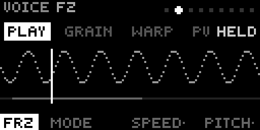 | 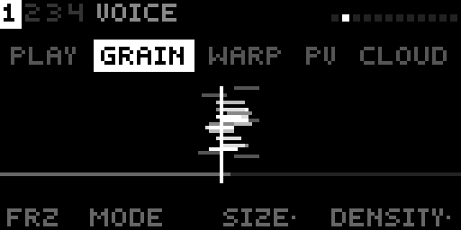 |
| PLAY: a clean loop, exact at pitch 1. | GRAIN: a cloud of small pieces of the take. |
| 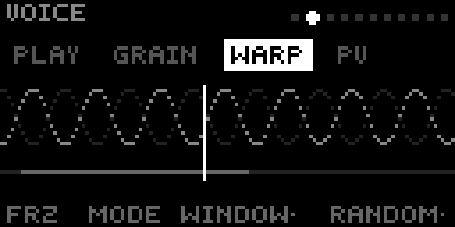 | 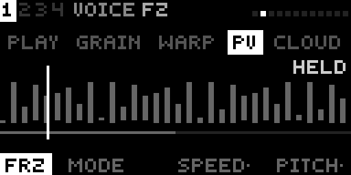 |
| WARP: slow or fast at the same pitch. | PV: a phase vocoder. A held head is a freeze. |

CLOUD is Mutable Instruments Clouds, for texture: `FourCloud` from the plugin, or
MiClouds. OFF silences the track and frees its CPU.

In PLAY on track 1, hold K1 for erode and wear. Each pass of the loop then rewrites the
take a little darker and quieter, and GEN counts the passes. K2 becomes HEAL: it parks the
decay. Recording is never affected.

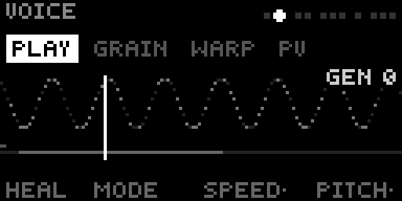

### TRACKS

| | |
|---|---|
| 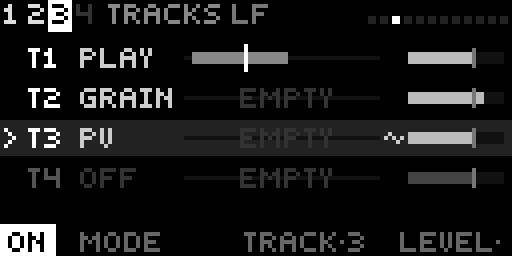 | 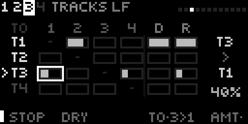 |
| E2 picks the track and E3 sets its level. | Hold K1: E2 picks where the track sends, E3 how much. |

The sends grid has a column for each track, D for the delay and R for the reverb. Every
send starts at zero. The echoes and the tail are added to the dry sound, which never ducks.

### FILTER and EFFECT

| | |
|---|---|
| 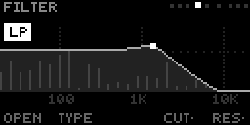 | 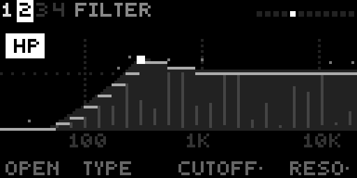 |
| E2 is the cutoff and E3 the resonance. | Hold K1 for drive and crush. |
| 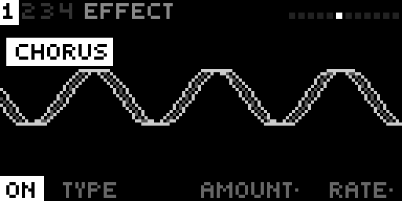 |  |
| CHORUS | FLANGE |
| 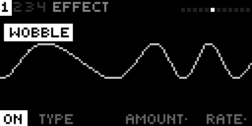 | 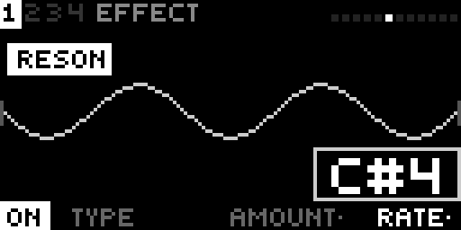 |
| WOBBLE: tape wow. | RESON: a tuned resonator. RATE is its note. |
| 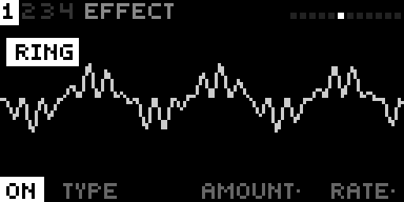 | |
| RING: a ring modulator. | |

The sixth type is ECHO, a delay of the track's own. On every type, E2 is the amount and E3
the rate. Hold K1 to turn the same two knobs of the second slot. The type of the second
slot is in PARAMS.

### DELAY, REVERB and MIX

| | |
|---|---|
| 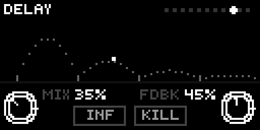 | 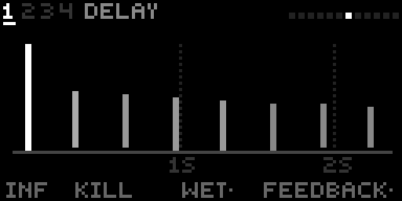 |
| Each bar is one echo. | K2 holds the echoes forever. |
| 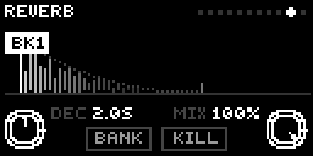 | 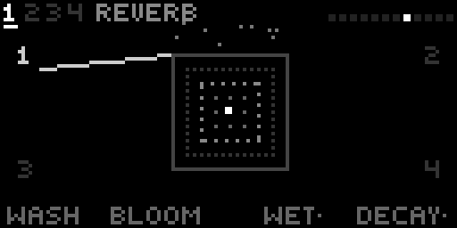 |
| The room: four squares, each denser than the one inside it. | K3 adds the shimmer. |

On REVERB, the four tracks stand at the four corners. A line from a corner is that
track's send. With the plugin, the reverb is `FourRoom`, a room of our own, and the delay
is `FourBBD`, a model of a bucket brigade chip: a long time is dark.

| | |
|---|---|
| 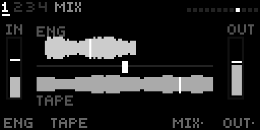 | 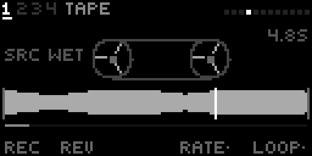 |
| MIX: E2 fades between the engine and the tape. | TAPE: a loop deck with its own speed and direction. |

A tape pass records what four plays: the tracks and their effects, and the input as far
as DRY/WET on MIX lets it through. The page says `SRC WET`. Hold K1 and turn E3 down to
`SRC DRY`, and a pass records the line input alone. If the source is silent while the
tape records, the page says `NO SOUND - K1+E3 SOURCE`. A new take starts at the start of
the tape. A take longer than the tape's 60 seconds fills it, and the page says
`TAPE FULL - 60 S`.

### PADS

| | |
|---|---|
| 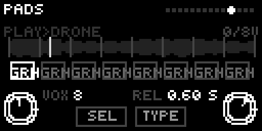 | 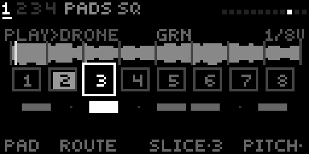 |
| E2 picks one of eight slices and K2 plays it. | The sequencer draws its pattern under the pads. |

Each slice has its own voice and pitch. Tap K3, and a MIDI or typing keyboard plays the
slices with many voices.

The sequencer (`PARAMS > pads - sequencer`) plays the pads on the clock. By default it
steps through four pads, a bar each. `steps that play` spreads that many hits over `steps`.
`pad order` walks the pads up, down, back and forth or at random. `step chance` skips hits
and `step gate` shortens them. Map `sequencer run` to a footswitch.

### MOTION

| | |
|---|---|
| 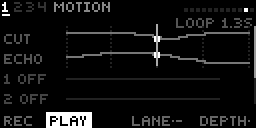 | 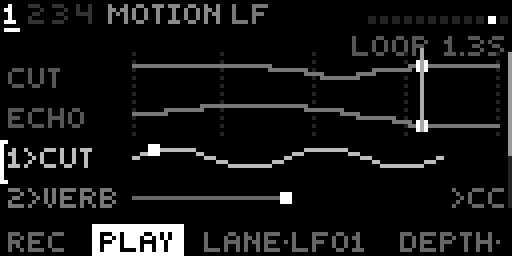 |
| K2 records your knob moves and K3 loops them. | Turn E2 past the last lane for the modulators. |

A motion loop of about a musical length snaps to that length, so it stays on the clock.

A modulator moves what the engine hears, never the knob. The knob stays where you, a scene
or a motion lane put it, and the sound swings around it. Each of the four modulators has a
target, a shape, a period and a depth. The shapes are sine, triangle, square, ramp, random
and ENV, the envelope of the input. A negative depth inverts the wave, so ENV with a
negative depth ducks the sound while your gear plays. With a modulator selected on MOTION,
E3 is its depth, K1+E2 its period and K1+E3 its target.

### SCENE

| | |
|---|---|
| 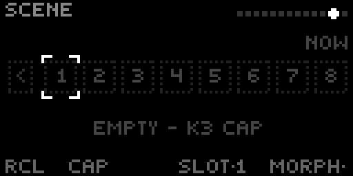 | 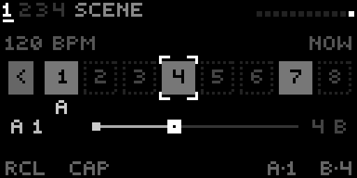 |
| E2 picks A and E3 picks B. Hold K1 and turn E3 to fade. | With A on a slot, the fade runs from A to B and back. |
| 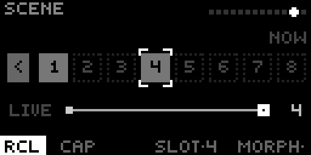 | 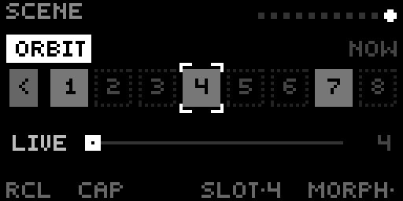 |
| Hold K2 to borrow B. | The orbit wanders between the stored scenes. |

- K3 captures the sound into the selected slot. K2 recalls it. Hold K2 to borrow the
  scene, and release to come back.
- SCENE is a crossfader with two ends, and each end has its own encoder. E2 picks A, the
  left end: LIVE or a stored slot. E3 picks B, the right end, which is also the slot that
  K2 and K3 act on. Hold K1 and turn E3 to fade. The rail names both ends, and a small A
  sits under the cell of slot A.
- With A on LIVE, the fade starts from the sound you have when it leaves 0. Back at 0 you
  hear that sound again.
- With A on a slot, the fade at 0 is A and at 1 is B, both ways. A new A changes nothing
  while the fade rests at 0. The first turn of the fade brings A in at once.
- If you pick another A during a fade, the fade keeps its A until it is back at 0, so the
  sound never jumps. The new A shows dim under its cell until then.
- An empty slot as A counts as LIVE. With B empty, the fade does nothing.
- The fade never lands a scene. At 1 the holds, the note routing, the buffer writers and the
  voice count are still as you left them, and K2 lands the rest of B.
- The orbit, a K2 peek and a GLIDE recall start from the sound you have, whatever A is.
- Slot zero, the left arrow, is the way back. Every recall parks the sound before it there.
- The orbit picks a scene, morphs part of the way, rests, and picks the next one. Start it
  with the `orbit run` parameter. Its drift time and its reach are in PARAMS > orbit.
- `recall quantize` sets the moment of a recall: NOW, the next BEAT or BAR, or GLIDE, a
  morph over `glide beats`.
- `capture scope` makes a scene of the effects only. It then lands on any material.

## The header

The header shows what runs, from every page. It starts with the four track cells:

- A white box is the track that the page edits. On a shared page such as DELAY, a line
  under the number marks the focused track.
- A bright number is a track that sounds. A dim one is silent.
- The track that records blinks as a box.

After the title, a T or an M with a blinking dot means that the tape or the motion loop
records. FZ and TF are the freezes, RP is a held beat repeat, SQ is the pad sequencer and LF
is a modulator.

## Recording

| | |
|---|---|
| 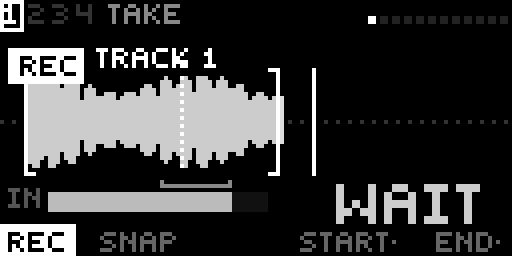 | 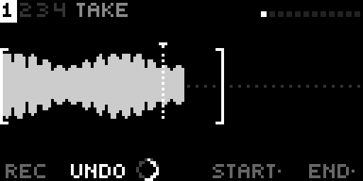 |
| With `start on sound`, an armed take waits. | Hold K3 for a second to undo the last change. |

- `PARAMS > take - record > start on sound`: the take starts where the sound starts, with a
  short pre-roll that keeps the attack.
- `PARAMS > take - window > win length`: the loop's length locks to the clock, from one beat
  to eight bars.
- Hold K3 on TAKE to go back to the take before the last change. Hold it again to come
  forward. A "<" at the top left means that there is a take to go back to.
- Hold K1 plus K3 for a second to erase the take. The arc shows the time left.

## Samples

- Load: PARAMS > take > load sample reads WAV files of 8, 16, 24 or 32 bits. A file at any
  sample rate loads in tune.
- Export: PARAMS > take > export take writes the take to `dust/audio` as a stereo WAV of
  24 bits.
- Print: PARAMS > take > print mix records the output and loads that recording as the
  take. The recording also stays on the card.

## Notes, beat repeat and other gear

A MIDI keyboard or a USB typing keyboard plays the take at pitch. The letters are the keys,
Z and X change the octave, and the space bar stops and starts everything. The settings are
in PARAMS > keys.

PARAMS > beat repeat is a stutter on the clock. Hold `beat repeat`, and the engine loops
the last division of what you hear until you let go. `repeat length` runs from a half note
to a 32nd.

PARAMS > modulation out sends the scene morph, the input envelope or a modulator's wave to
other gear. It goes out as a MIDI CC, and as 0 to 5 volts on crow output 1.

## Saving

PARAMS > PSET saves the whole session: the parameters, the MIDI map, the four takes, the
tape, the scenes, the motion loop and the slices.

## Grid

Rows one and two are scenes and transport. Rows seven and eight are a piano octave. The
middle rows follow the page: loop spans, slice pads or the morph bar. On a Launchpad Mini
MK3 the colours have meanings: red records, green plays, white is the cursor and purple
erases. `lib/mgrid.lua` has the details.

## Visuals

`lib/mosc.lua` sends the state of the instrument as OSC. `visuals/` holds a bridge that
feeds it to Hydra in a browser: see [visuals/README.md](../visuals/README.md). The visuals
ran with mangler, four's predecessor, and are not yet tested with four.

## Signal flow

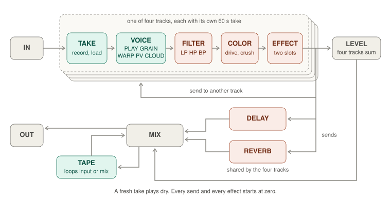

softcut runs the tape on its own core. One SuperCollider engine, `lib/Engine_Four.sc`,
does the recording, the voices and the effects. Only what you hear costs CPU: a track that
is off, an effect at zero and a reverb at zero do not run.

## Troubleshooting

1. Every script hangs on LOADING. A second engine class is under `dust/code`. Deploy again
   with `rsync --delete`. The errors are in maiden's SC tab, not in matron.
2. An engine edit changes nothing. You did not do SYSTEM > RESTART, or the count is not
   `count: 198`.
3. A dry take has reverb on it. Look at the system reverb in PARAMS and at the delay and
   reverb levels. A tap of K1 plus K3 turns all effects off.
4. The delay or the reverb is silent. No track sends to it, and the page says `NO SEND`.
   On TRACKS, hold K1 and open the send D or R.
5. Some reverb parameters do nothing. The room reads only decay, damp and size.
6. A loop plays that is not the take. It is the tape. MIX shows which deck you hear. Erase
   the tape on TAPE with K1 plus K3.
7. The tape records nothing, and TAPE says `NO SOUND`. Its source is silent. At `SRC WET`
   it records what four plays, and at `SRC DRY` the line input alone. On TAPE, hold K1
   and turn E3.
8. The screen is black or frozen after the load. A Lua error is inside the redraw. Scroll
   maiden below the ok line for the traceback.
9. WARP, PV and CLOUD sound plain, and the SuperCollider tab says
   `four: FourStretch absent`. Do SYSTEM > RESTART. If the plugin is still absent, see
   [ugen/README.md](../ugen/README.md).
10. The sound drops out. SuperCollider is over its share of the processor. Set the tracks
    you do not use to OFF: a CLOUD track keeps working in silence.

## Roadmap

The plan for the effects is [doc/space-plan.md](space-plan.md). The room reverb, the
bucket brigade delay and the sends are built. Planned next:

- Knobs for the delay's AGE (noise) and TONE, and for the room's COLOR.
- The room's first reflections, and SIZE that moves while the room plays.
- CHORUS and ECHO on the bucket brigade, RESON as a string, WOBBLE as a tape model.
- A screen with fixed rules: geometry only, four levels of grey, and motion only where
  there is sound.

## For developers

To work from a clone, copy the script to the norns:

```sh
rsync -av --delete --exclude='.git' --exclude='.claude' ./ we@norns.local:~/dust/code/four/
```

Then do SYSTEM > RESTART on the norns, and pick four in SELECT. Three rules:

1. Keep `--delete`. A second copy of `Engine_Four.sc` under `dust/code` hangs every norns
   script on LOADING.
2. If the engine file changes, do SYSTEM > RESTART. A Lua change needs only a script
   reload.
3. After a restart, maiden prints the engine's command count. It must read `count: 198`.
   A different number means that an old engine still runs.

The documents:

- [doc/README.md](README.md): every document, for players and for developers.

- [.claude/CLAUDE.md](../.claude/CLAUDE.md): the status on the device, the hard rules, the lessons, and which
  documents are current.
- [doc/plan.md](plan.md): the next work.
- [doc/changelog.md](changelog.md): every change, oldest first.
- [doc/device-gate.md](device-gate.md): the walkthrough on the device.
- [doc/engine-map.md](engine-map.md): why the engine has its shape. It was written for
  the engine of mangler, four's one-track predecessor.
- [doc/norns-platform.md](norns-platform.md): costs, budgets and platform traps.
- `lua test/check.lua` runs every check. `python3 test/uisim/gallery.py` rebuilds the
  pictures of this page from the real redraw code, with no hardware.
- `dist/four_single.lua` is a generated single file. Edit the modules in `lib/`.
